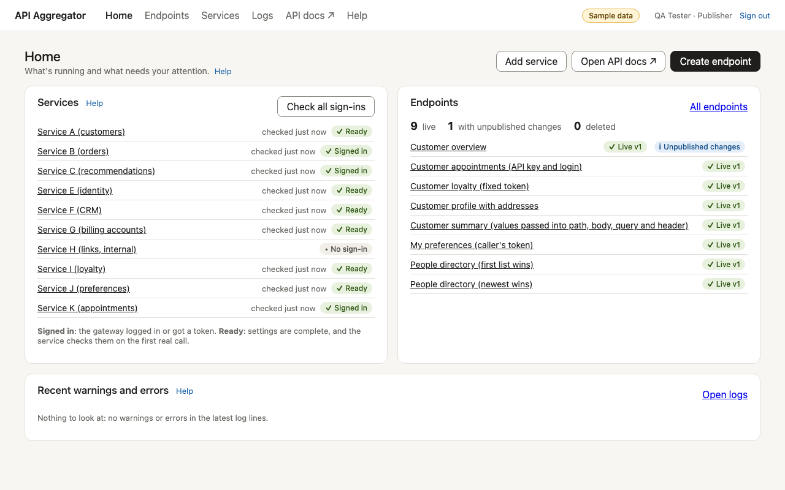

# API Aggregator

Combine calls to several backend APIs into **one endpoint** for your web and mobile apps, built in an
admin UI without writing code.

```
GET /bff/customer/C-10042/summary
   ├─ Service A  GET  /customers/C-10042                     (Basic auth)
   ├─ Service I  GET  /loyalty/<A.id>                        (fixed token)
   ├─ Service B  POST /orders/search  { "customerId": <A.id> } (login session)
   └─ Service C  GET  /recommendations?segment=<A.segment>   (OAuth → JWT)
                      X-Tier: <I.tier>
```

- **Many aggregated endpoints**, each built, tested, published and rolled back in a guided wizard, with no redeploy.
- **Values passed between calls** into the path, query, header or body. Calls that don't depend on each other run in parallel.
- **Any sign-in, in any combination:** Basic, login session, OAuth client credentials, API key, fixed token, or the caller's own token.
- **Combine lists** from several services into one list of records, on exact shared ids only.
- **Secure by default:** declared inputs only, escaped values, secrets by reference, per-user caching, no values in logs.
- **API docs** at `/bff/docs` and a typed `/bff/openapi.json` for generating app clients.

## Quick start

Needs the .NET 10 SDK on macOS or Linux (or Docker: `docker compose up --build`).

```bash
dotnet build
./scripts/dev-run.sh          # mocks :5100, gateway :5200, admin app :5300 (sample data)
open http://localhost:5300    # the admin UI: sign in with any name, pick author or publisher
./scripts/try-gateway.sh      # in another terminal: call the sample endpoints
```

The full walk-through, including your own configuration (`./scripts/dev-run.sh --real`), is in
[Getting started](docs/guides/getting-started.md).



## Documentation

**[docs/README.md](docs/README.md)** is the index, by audience:

| I'm… | Start with |
|---|---|
| A technician or tester | [Adding services](docs/guides/adding-services.md), [Building endpoints](docs/guides/building-endpoints.md) |
| Building an app | [For app developers](docs/guides/for-app-developers.md) |
| Running the platform | [Operations](docs/guides/operations.md), [Security and privacy](docs/guides/security-and-privacy.md) |
| Changing the code | [`CLAUDE.md`](CLAUDE.md), [architecture](docs/architecture/01-overview.md), [decisions](docs/adr/README.md) |

Every example in the guides runs against the mock services: `./scripts/check-docs.sh` (also part of `dotnet test`).

## Commands

```bash
dotnet test                                                                          # all tests
./scripts/check-docs.sh                                                              # the guides' examples
dotnet run --project tools/ApiAggregator.Cli -- validate --config samples/config     # check every endpoint and sign-in
./scripts/install-playwright.sh && ./scripts/screenshots.sh                          # browser for UI tests; refresh docs/images
```

## Status

Development-ready. Before production, work through the "Next" list in the [roadmap](docs/roadmap.md):
PostgreSQL config store, Key Vault, telemetry, and a security and privacy
review for health or personal data.
