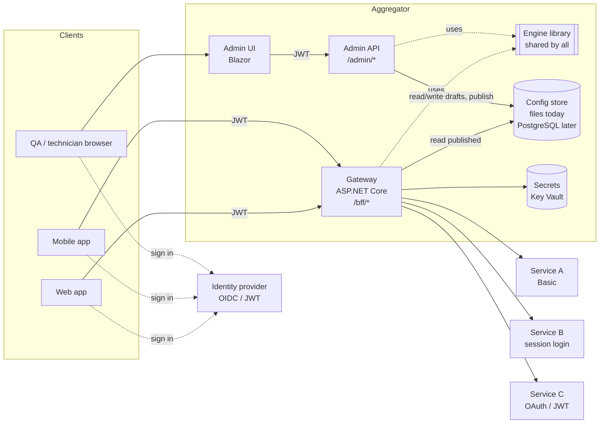
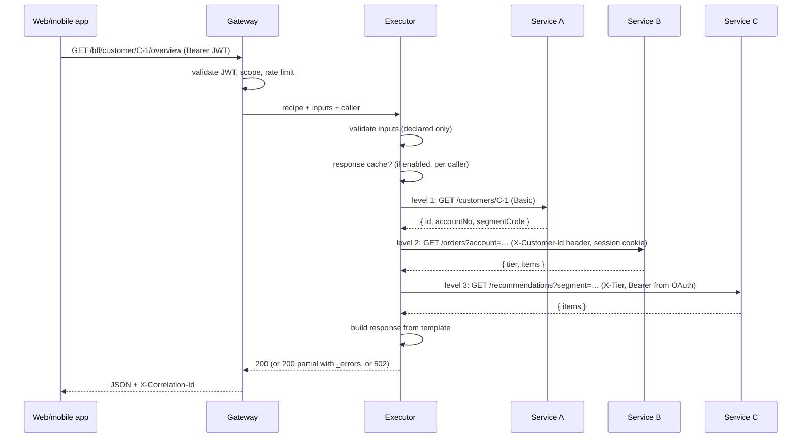

# 01 — Overview

## Problem

Web and mobile apps need data from several backend services (Service A, B, C…). Calling each one
from the client is slow on mobile networks, leaks internal structure, duplicates auth logic in
every app and makes every screen fragile. We want **one call per screen**, composed on the server.

## What the system does

- Hosts **many aggregated endpoints** (for example `GET /bff/customer/{id}/overview`). Each one is a
  **recipe**: a list of steps that call service endpoints and a template for the response.
- Lets **QA and technicians** build, test and publish recipes in a guided **admin UI**, without code
  and without editing JSON.
- Passes values between calls: one service's response ID can go into another service's path, query,
  header, cookie or body. One step can use values from several earlier steps.
- Signs in to each downstream service the way that service expects: Basic auth, a session login,
  a JWT or OAuth token, an API key, or the caller's own token, in any combination.
- Imports service endpoints from **OpenAPI** specs when a service has one.
- **Caching**, switched on or off per endpoint and per step. Entries are kept per caller by default.

## Goals and non-goals

| Goals | Non-goals |
|---|---|
| Simple, readable code; one obvious place for each concern | A general workflow or ESB engine |
| Fast: parallel calls, pooled connections, no reflection, cached plans | Arbitrary scripting in recipes (no code execution, by design) |
| Secure by default: deny-by-default inputs, per-caller cache, secrets by reference | Replacing an API management product (rate plans, developer portal) |
| Safe change: drafts, test before publish, versioned history, one-click rollback | Transforming binary content (files, images) |

## Containers

| Container | Responsibility | Code |
|---|---|---|
| **Engine** | Recipe model, expression language, planner, validator, executor, downstream auth, caching | `src/ApiAggregator.Engine` (no NuGet dependencies) |
| **Gateway** | Serves **published** recipes under `/bff/*`; inbound JWT, scopes, rate limiting, resilience | `src/ApiAggregator.Gateway` |
| **Admin API** | Services, auth profiles, OpenAPI import, drafts, test runs, publish and rollback | `src/ApiAggregator.Admin.Api` |
| **Admin UI** | The wizard QA and technicians use | `src/ApiAggregator.Admin.UI` |
| **Hosting** | Shared inbound-JWT setup for the two web hosts | `src/ApiAggregator.Hosting` |
| **CLI** | `aggregator validate` / `aggregator run` for QA and CI | `tools/ApiAggregator.Cli` |
| **Mock services** | Services A/B/C with Basic, session and OAuth auth, for local work and demos | `samples/MockServices` |

## Request lifecycle (gateway)

Steps in the same level run **in parallel**. Levels are worked out from the bindings: if step `b`
reads `a.body.id`, then `b` waits for `a`. Nobody has to wire dependencies by hand.

## Outcomes the caller can see

| Situation | HTTP | Body |
|---|---|---|
| Everything succeeded | 200 | Response template |
| An **optional** step failed | 200 | Response template plus `_errors`, and header `X-Aggregator-Partial: true` |
| A **required** step failed | 502 | `{ title, errors }` naming the root cause only |
| Inputs missing or invalid | 400 | `{ title, errors }` in plain English |
| No or invalid token / missing scope | 401 / 403 | — |
| Too many requests from one caller | 429 | — |
| No published endpoint at that path | 404 | — |

## Technology

.NET 10 (LTS), ASP.NET Core minimal APIs, System.Text.Json, `IHttpClientFactory` with
`SocketsHttpHandler`, Microsoft.Extensions.Http.Resilience, built-in rate limiting, Blazor
(interactive server) for the UI, Microsoft.OpenApi for imports. PostgreSQL, Redis and Azure Key Vault
are the planned production backing services (see [roadmap](../roadmap.md)).

## Read next

- [02 — Recipes: the composition model](02-recipes.md)
- [03 — Authentication and security](03-auth-and-security.md)
- [04 — Admin UI, lifecycle and OpenAPI import](04-admin-and-openapi.md)
- [05 — Operations, performance and scaling](05-operations.md)
- [06 — Testing](06-testing.md)
- [ADRs](../adr/)
