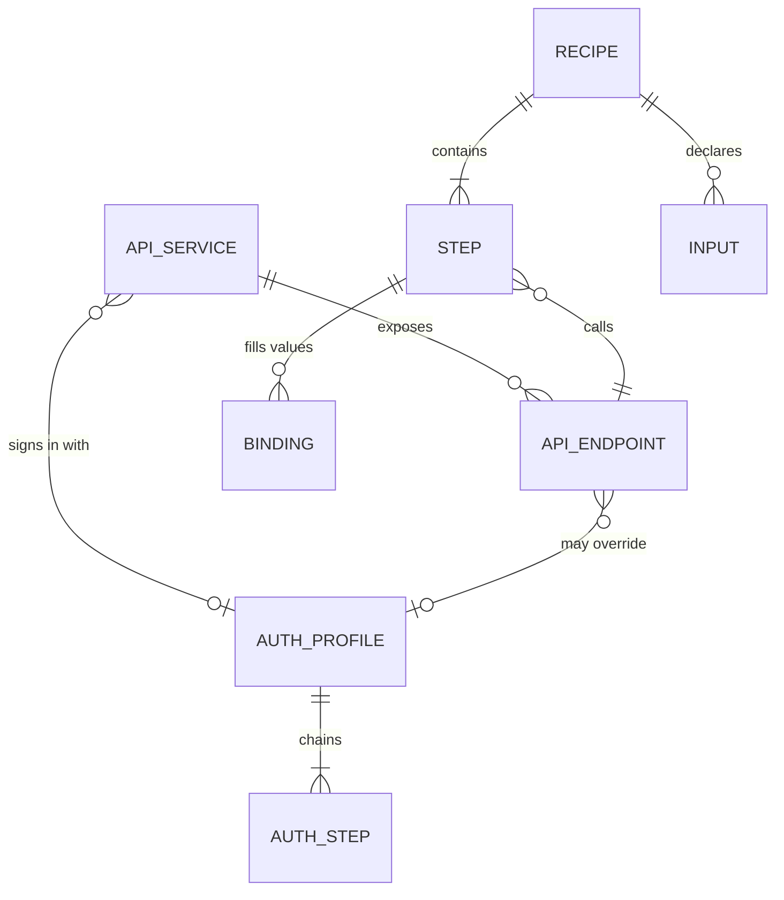

# 02 — Recipes: the composition model

A **recipe** defines one aggregated endpoint. The gateway hosts any number of them. Each is
versioned and published independently. Recipes are JSON (`config/recipes/*.json`), but QA and
technicians build them in the admin UI and never need to edit the JSON.

Full example: [`config/recipes/customer-overview.json`](../../config/recipes/customer-overview.json).

## Building blocks



| Concept | Where | What it is |
|---|---|---|
| Service | `config/services.json` | A downstream API (base URL, timeout, auth profile) and its endpoints |
| Endpoint | inside a service | One operation: method, path template, parameters, schemas. Imported from OpenAPI or added by hand |
| Auth profile | `config/auth-profiles.json` | Ordered auth steps; see [03](03-auth-and-security.md) |
| Recipe | `config/recipes/<id>.json` | One aggregated endpoint (published) |
| Draft | `config/drafts/<id>.json` | Work in progress; never served |
| History | `config/history/<id>.v<n>.json` | Every published version, kept for audit and rollback |

## Recipe fields

| Field | Example | Notes |
|---|---|---|
| `id` | `customer-overview` | Lowercase slug, also the file name |
| `method`, `route` | `GET`, `customer/{id}/overview` | Served at `/bff/<route>` |
| `requireAuthentication` | `true` | Default `true` |
| `requiredScope` | `customer.read` | Optional OAuth scope the caller must have |
| `inputs` | see below | **Only declared inputs are accepted** |
| `steps` | see below | Max 25 |
| `response` | JSON template | Omit it to return each step's body under its alias |
| `cache` | `{ "enabled": true, "ttlSeconds": 30 }` | Whole-response cache (off by default) |
| `timeoutMs` | `8000` | Hard limit for the whole composition |

## Inputs

```json
"inputs": {
  "route.id":     { "type": "string", "required": true, "pattern": "^[A-Za-z0-9-]{1,40}$" },
  "query.status": { "type": "string", "enum": ["open", "closed"], "default": "open" },
  "query.page":   { "type": "int", "min": 1, "max": 100, "default": "1" },
  "header.X-Tenant": { "type": "string" }
}
```

Types: `string`, `int`, `number`, `bool`, `date`. Checks: `required`, `pattern` (with a 50 ms regex
timeout), `enum`, `min`/`max`, `maxLength` (default 200), and no control characters. Anything the
caller sends that is not declared is **ignored and never forwarded**. This rule exists to stop
parameter smuggling.

## Steps and bindings

```json
{
  "alias": "b",
  "displayName": "Get orders",
  "endpoint": "service-b/getOrders",
  "required": true,
  "bind": [
    { "from": "a.body.id",            "to": "header.X-Customer-Id" },
    { "from": "a.body.accountNo",     "to": "query.account" },
    { "from": "request.query.status", "to": "query.status" },
    { "template": { "ids": "{{a.body.orderIds}}" }, "to": "body" }
  ]
}
```

**Sources** (`from`, or `{{ }}` inside `template`):

| Root | Meaning |
|---|---|
| `request.route.*`, `request.query.*`, `request.header.*` | Declared caller inputs |
| `request.claims.*` | Claims from the caller's validated JWT, e.g. `request.claims.sub` |
| `<alias>.body.*`, `<alias>.headers.*`, `<alias>.status` | An earlier step's response |
| `item`, `index` | The current element inside a `forEach` step |
| `ctx.correlationId`, `ctx.subject` | Request context |

**Targets** (`to`): `path.<name>`, `query.<name>`, `header.<Name>`, `cookie.<name>`, `body`, or
`body.<dotted.path>`. Values are escaped for their target. An array bound to a query parameter
becomes a repeated parameter (`?id=1&id=2`). You can't set `Authorization`, `Cookie`, `Host`,
hop-by-hop or length headers, because auth profiles and the HTTP stack handle those.

**Path language** (deliberately small, with no code execution):

| Syntax | Example |
|---|---|
| Property | `a.body.customer.id` |
| Index (negative counts from the end) | `a.body.items[0]`, `a.body.items[-1]` |
| Slice, then project | `a.body.items[0:5].id` → array of ids |
| Wildcard | `lines[*].body` |
| Quoted property | `a.headers['X-Trace-Id']` |
| Transforms | `a.body.ids \| join(',')`, `\| count`, `\| first`, `\| last`, `\| default('n/a')`, `\| upper`, `\| lower`, `\| trim`, `\| string` |

## Run order, conditions, fan-out

- **Dependencies are inferred.** The planner groups steps into levels, and steps in the same level
  run in parallel. A recipe whose steps depend on each other in a loop can't be saved.
- **`when`**: `"{{a.body.isPremium}}"` or `"{{a.body.status}} == active"` or `!=`. If the condition
  is false, the step is *skipped*. That's not an error, and steps that depend on it are skipped too.
- **`forEach`**: `"{{b.body.items[0:3].id}}"` runs the step once per item, with at most
  `maxConcurrency` calls in flight (default 4) and at most 100 items (`MaxForEachItems`). The step's
  output is an array of `{ status, headers, body }`.

## Failure semantics

- Each failed step gets an **error code**: `auth_failed`, `unauthorized`, `forbidden`, `not_found`,
  `bad_request`, `rate_limited`, `server_error`, `timeout`, `unreachable`, `invalid_response`,
  `missing_value`. The full table is in [ADR 0009](../adr/0009-error-contract-and-logging.md).
- Steps that depend on a failed step get `dependency_failed` and aren't run. Only **root causes**
  are reported to the caller.
- If a `required` step fails (the default), the call returns **502**, or **504** when every root cause
  is a timeout. The body is problem details with `errors[]`.
- If an optional step fails, the call returns **200** with `_errors[]`, entries of the same shape
  (`step`, `name`, `service`, `code`, `status`, `message`, `retryable`).
- On a `401` from a service whose profile uses a cached session or token, the engine drops the
  cached credential, signs in again and retries **once**. If it still gets 401, the code is
  `unauthorized`. If signing in itself fails, the code is `auth_failed`.

## Caching (on/off)

```json
"cache": { "enabled": true, "ttlSeconds": 30, "perCaller": true }
```

| Level | What is cached | When it's used |
|---|---|---|
| Recipe | The whole composed response (200, non-partial only) | Same recipe version + same inputs + same caller |
| Step | One downstream response (2xx only) | Same endpoint + same final request + same caller |

Security rules:

- **Per caller by default.** The caller's `sub` is part of the key, so one user can never receive
  another user's data. Set `perCaller: false` **only** for data that is the same for everyone
  (reference lists, public catalogues). **Never** set it for customer or patient data.
- Keys are **SHA-256 hashed**, so identifiers never appear in a key. Keys also include the config
  version, so editing or republishing a recipe can never serve an old response shape.
- Responses always carry `Cache-Control: no-store`, so browsers and proxies never cache them. Only
  the gateway caches.
- Memory is bounded (`CacheSizeMb`, default 256). With several gateway instances each one has its
  own cache. A shared Redis cache is on the [roadmap](../roadmap.md).
