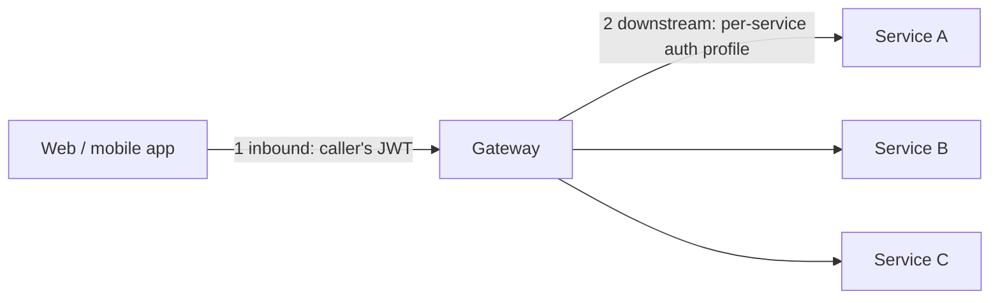

# 03 — Authentication and security

## Two separate trust boundaries

1. **Inbound (caller → gateway, or a script → `/admin/*`).** A JWT validated by ASP.NET Core JWT bearer against
   your OpenID Connect provider (`Auth:Authority`, `Auth:Audience`). Each recipe can require a
   **scope**, for example `customer.read`. Admin roles are `aggregator.author` and `aggregator.publisher`,
   as scopes or role claims. People using the admin **pages** sign in separately, see
   [Admin sign-in](#admin-sign-in-and-csrf). In Development only, `Auth:DevSigningKey` enables a local token issuer at
   `/dev/token`. Startup **fails** if that key is set in any other environment.
2. **Downstream (gateway → service).** Each service has an **auth profile**. The caller's token is
   **not** forwarded unless the profile explicitly says so.

## Downstream auth profiles: any combination

A profile is an ordered list of steps. Each step adds something to the outgoing request, so a
profile can combine them, for example `[ApiKey, SessionLogin]`.

| Kind | Settings | Use when |
|---|---|---|
| `Basic` | `username`, `password` | The service uses HTTP Basic |
| `ApiKey` | `name`, `value`, `in` = `header` or `query` | A static key |
| `StaticBearer` | `token`, `header` (optional) | A long-lived token or JWT issued to the gateway |
| `OAuthClientCredentials` | `tokenUrl`, `clientId`, `clientSecret`, `scope`, `audience` | The service accepts OAuth access tokens (usually JWTs). Cached until 60 s before expiry |
| `SessionLogin` | `loginUrl`, `username`, `password`, `format` (`json`/`form`), `usernameField`, `passwordField`, `loginUsesBasic`, `tokenPath`, `tokenHeader`, `ttlSeconds` | Username/password login that returns a **session cookie**, a **JWT in the body**, or both. `loginUsesBasic: true` covers "Basic login → session/JWT" |
| `PassThroughUserToken` | `header` (optional) | The service trusts the same identity provider and audience as the gateway |

Examples:

- **Basic only:** `[{ "kind": "Basic", ... }]`
- **Session cookie:** `[{ "kind": "SessionLogin", "settings": { "loginUrl": "...", "username": "svc-b", "password": "secret:svc-b-pw" } }]`
- **Login → JWT → Bearer:** `SessionLogin` with `tokenPath: "data.accessToken"`
- **Basic login → session + API key:** `[{ "kind": "ApiKey", ... }, { "kind": "SessionLogin", "settings": { "loginUsesBasic": "true", ... } }]`

**Credential caching.** Tokens and sessions are cached in memory per profile with *single flight*:
when 200 requests arrive with an expired session, exactly **one** login call is made. They are
never logged, never written to disk and never cached per user. On a `401`, the cached credential
is dropped and the call is retried once.

**When downstream auth fails.** The caller gets a problem-details response with code `auth_failed`
(the gateway couldn't sign in) or `unauthorized` / `forbidden` (the service refused the credentials),
plus the service id, `retryable: false` and a correlation id. They never get the profile name,
setting names or secret names. Those go to the log (event 1200 `DownstreamAuthFailed`, 1101
`StepFailed`) and to admin "Try it". In the admin UI, **Check sign-in** runs the same sign-in on
demand.

**Secrets.** Settings whose value starts with `secret:` are resolved at run time through
`ISecretResolver`. Development reads `Secrets:<name>` from configuration (user-secrets or
environment variables). Production should use Azure Key Vault (the Key Vault configuration provider
or a Key Vault `ISecretResolver`). When a profile is saved, the admin app **rejects** a profile that
puts a password, secret, token or key value in plain text.

## Built-in protections

| Threat | Protection | Where |
|---|---|---|
| Parameter smuggling (caller adds `?admin=true`) | Only declared inputs pass; typed and validated | `InputBinder` |
| Path traversal / changing the destination | Values URL-escaped; `.`/`..` rejected; final URL must stay on the service's host and base path | `RequestBuilder` |
| Header injection (CR/LF) | Rejected; 4 KB limit; security headers can't be bound | `RequestBuilder`, `RecipeValidator` |
| Session leakage between users | `UseCookies = false` (no shared cookie jar); per-caller cache keys | `ServiceCollectionExtensions`, `CacheKeys` |
| Credential replay to another host | `AllowAutoRedirect = false` | `ServiceCollectionExtensions` |
| ReDoS in input patterns | 50 ms regex timeout | `InputBinder`, `RecipeValidator` |
| Huge or slow downstream responses | 5 MB cap, per-step and per-recipe timeouts | `CompositionExecutor` |
| Fan-out amplification | `forEach` capped at 100 items with bounded concurrency; 25 steps max | `CompositionExecutor`, `RecipeValidator` |
| Abuse / brute force | Per-caller fixed-window rate limit (default 600/min) | Gateway |
| Downstream outages | Standard resilience handler: retries **only idempotent methods**, circuit breaker, timeouts | Gateway |
| Leaking internals in errors | Callers get a code and a safe message ("Service X answered 404"); internal detail only in logs and admin traces; never downstream bodies or stack traces | `CompositionExecutor`, ADR 0009 |
| Identifiers or tokens in logs | Default HttpClient logging removed; our own logs carry ids, codes and timings only; the request log uses the recipe id, not the raw path | `EngineLog`, gateway request log |
| Browser/proxy caching of personal data | `Cache-Control: no-store`, `nosniff`, `no-referrer`; no `Server` header | Gateway |
| Unreviewed changes going live | Drafts are separate; publish needs `aggregator.publisher` **and** a passing test of the exact draft. Checked inside `AdminService`, so pages and `/admin/*` follow the same rule | `AdminService` |
| Cross-site request forgery on the admin app | `/admin/*` accepts bearer tokens only, never the page cookie; the cookie is `HttpOnly`, `SameSite=Lax`, `Secure`; sign-in and sign-out need an antiforgery token; the Blazor connection must come from the app's own origin | `AdminAuth` |
| SSRF via OpenAPI import | Admin-only; http(s) only; no redirects; optional host allow-list `Admin:OpenApiAllowedHosts` | `OpenApiImporter` |
| Code injection through recipes | No scripting: a fixed path language and a fixed transform list | `ValuePath`, `Transforms` |

## Audit

The gateway writes one structured log line per composition: recipe, version, caller `sub`, status,
duration, each step's outcome and the correlation ID. It **never** logs values. The admin app logs
who published and who rolled back. Each published version is stored in `config/history/`.
**Open item:** ship these logs to a tamper-evident store with a retention period agreed with your
compliance team.

## Admin sign-in and CSRF

The admin app ([ADR 0014](../adr/0014-one-admin-app.md)) has two schemes that never mix:

| | Pages | `/admin/*` |
|---|---|---|
| Credential | Cookie `aggregator.admin`: `HttpOnly`, `SameSite=Lax`, `Secure` outside Development, 8 hours sliding | Bearer token (JWT) only |
| Who issues it | **Development:** `/signin`, a name and a role (author or publisher), no password. Only mapped in Development. **Production:** OpenID Connect, authorization code flow with PKCE (`Auth:Oidc:Authority`, `ClientId`, `ClientSecret` from Key Vault or user secrets; `RoleClaim`, default `roles`; `Scopes`) | Your identity provider, or `/dev/token` in Development |
| CSRF | Sign-in and sign-out are POST forms with an antiforgery token. The Blazor connection (`/_blazor`) is refused when its `Origin` header isn't this app. `SameSite=Lax` keeps the cookie off cross-site posts, frames and WebSocket requests | The policies name only the bearer scheme, so the cookie is never read: a request with only the cookie gets **401** |

- Outside Development the admin app **refuses to start** without `Auth:Oidc:Authority` and `ClientId`.
- Roles are checked inside `AdminService` on every action. Pages hide what you can't do, but don't decide.
- The person's OIDC access token is kept in server memory only, keyed by a random session id (never in the
  cookie or the page), and is dropped on sign-out. It's used for Try it against "caller's own token" services
  and to read the gateway's live logs.
- History records `by` (the person's `sub`) and `byName` (their display name, when the sign-in gives one).

## Health and personal data (needs specialist review)

The aggregator passes through whatever the downstream services return. If those services hold
health information or other personal information, the aggregator handles it in transit and,
when caching is on, in memory.

Design choices that help:
- Responses are never cached in browsers or proxies.
- Cache entries are kept per caller and expire.
- Cache keys are hashed.
- Logs record which recipe ran and who called it, never the values.
- Admin traces mask query values.
- History records **who** changed an endpoint as an id (`sub`) and, since ADR 0014, the display name from their sign-in (the `name` claim; check your provider doesn't put an email there), and holds no request data.
- Use identifiers in headers or bodies rather than query strings where you can.

**Not decided here — review with qualified people:**

- **Australia:** obligations under the *Privacy Act 1988* and the Australian Privacy Principles
  (in particular APP 11, security of personal information), the Notifiable Data Breaches scheme,
  and, if any connected system touches My Health Record, the *My Health Records Act 2012* and the
  Australian Digital Health Agency's requirements. Decide whether caching is allowed at all for
  health data, and set a maximum TTL.
- **Data residency:** where gateway instances and caches run.
- **Retention** of logs and history, and who can read them. Since ADR 0012, each history entry records
  the publisher's user id (`sub`) and a time, and since ADR 0014 their display name; history is never pruned or changed. Decide how long
  actor ids are kept, and whether a minimum retention applies for audit.
- **Penetration test and threat model sign-off** before production.

These need sign-off by your privacy officer, security team and legal advisers. This document does not
give legal advice.
