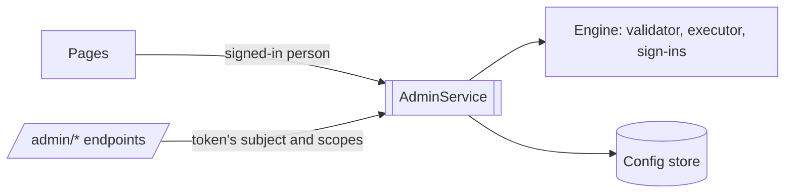
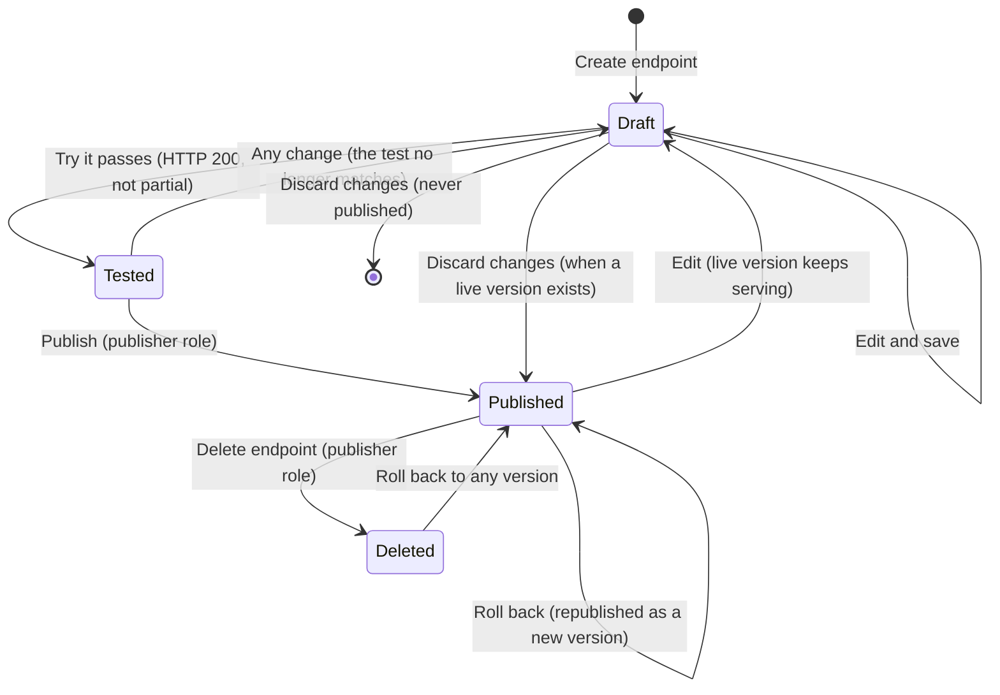

# 04 — Admin app, lifecycle and OpenAPI import

## One app: pages and `/admin/*`

The admin app (`src/ApiAggregator.Admin`, port 5300, [ADR 0014](../adr/0014-one-admin-app.md)) serves the Blazor
pages technicians use and the `/admin/*` HTTP API for scripts and CI. Both call `AdminService`
(`src/ApiAggregator.Admin.Application`), which holds every rule and role check, so a page and a script get exactly
the same answer. Pages sign in with a cookie (development sign-in, or OpenID Connect); `/admin/*` takes bearer
tokens only ([03](03-auth-and-security.md#admin-sign-in-and-csrf)).

Rule, checked by `ArchitectureTests`: pages and components use `AdminService`, never the store or the engine,
and `AdminService` uses no HTTP or Blazor types. The same goes for the MCP tools.

## MCP server for AI agents (`/mcp`)

The admin app also serves an MCP server ([ADR 0021](../adr/0021-mcp-server-for-ai-agents.md), guide:
[For AI agents](../guides/for-ai-agents.md)). It uses Streamable HTTP with the official C# SDK; clients that start
with `initialize` keep a session. Access needs a bearer token with `aggregator.mcp`, as described in
[03](03-auth-and-security.md#ai-agents-mcp-adr-0021). `src/ApiAggregator.Admin/Mcp/`:
- `McpHosting`: registration, the body-size limit, the rate limit and the per-call log line.
- `McpCall`: who is asking (`AdminActor` with `Via = Mcp` and the client's name), JSON results, plain-English
  refusals as error results, and size limits.
- `AggregatorTools`: one `AdminService` call per tool.

The MCP-only rules live in `AdminService`, keyed on `actor.Via`:
- tries hide values outside the sample data and never count for publishing;
- spec addresses are allowed only on service hosts;
- credential-looking settings are refused.

| Tool | `AdminService` |
|---|---|
| `list_services`, `get_service` | `GetServicesAsync` |
| `list_sign_ins`, `list_sign_in_kinds` | `GetAuthProfilesAsync`, `GetAuthKinds` |
| `list_endpoints`, `get_endpoint` | `GetRecipesAsync`, `ExportRecipeAsync` |
| `get_recipe_schema`, `get_path_language` | `GetRecipeSchema`, `GetPathLanguage` |
| `list_source_fields` | `GetSourcesForAsync` |
| `validate_recipe` | `ValidateRecipeAsync` |
| `import_openapi_service` | `SaveServiceAsync` (new service) and `ImportOpenApiAsync` |
| `add_service`, `update_service` | `SaveServiceAsync` |
| `save_sign_in` | `SaveAuthProfileAsync`, then `SecretExistsAsync` for each reference |
| `save_endpoint_draft` | `ImportDraftAsync` |
| `try_endpoint_draft` | `TestAsync` |

## In-app help

**Help** (`/help`) is written for technicians first, with "What this does underneath" folded away for developers.
`/help` asks *what do you want to do?* (Add a service · Build an endpoint · Test and publish · Fix a problem) and offers
the guided walkthrough; each topic is its own short page, `/help/{topic}`, one Razor component in `Components/Help/`,
listed in `HelpTopics` (title, summary, full guide). Reference pages (errors apps receive, logs, browser access, API
docs, words) keep their tables. Screens link with `HelpLink Topic="…"`; topics that became part of another page
(`history`, `sign-in`…) still resolve (`HelpTopics.Href`), and a test checks every topic used in the app exists. Each
page links to its full guide in `docs/guides/` (**Full guide**, from `Docs:BaseUrl`), whose examples `check-docs.sh`
keeps true. Technician text is mirrored in both: change both.

**Guided walkthrough.** `/endpoints/new?guide=first` opens "Guide: build your first endpoint" above the editor: 8 steps
that build the sample `contacts-unique` with the pickers only (contacts, orders, notes once for each order's contact,
the answer, Try it). Each step ticks itself off from the form (`FirstEndpointGuide`, pure and unit-tested); only the
current one is open, with **Show me** (jumps to the section) and "What this does underneath". The guide survives the
first save (the address keeps `?guide=first`). Without the sample CRM (real mode) it says it needs the sample data.

## Who does what

| Person | Can | Role (page sign-in role claim, or token scope) |
|---|---|---|
| Developer / admin | Register services, set up auth profiles and secret references | `aggregator.author` (profiles and services) |
| QA / technician | Build aggregated endpoints in the wizard, run "Try it", save drafts | `aggregator.author` |
| Approver | Publish, roll back and delete endpoints | `aggregator.publisher` (includes author) |
| Platform admin | Add, edit and remove the websites allowed to call `/bff/*` from a browser (**Settings → Browser access (CORS)**). Authors and publishers can look and use **Test an origin** | `aggregator.admin` (separate: gives no author or publisher rights) |

In Development, `/signin` asks for a name, a role and whether you are also an admin. In production the roles come
from the identity provider (app roles named `aggregator.author`, `aggregator.publisher` and `aggregator.admin`; the
claim is set by `Auth:Oidc:RoleClaim`).

## Browser access (CORS) page

**Settings → Browser access (CORS)** (`/settings/browser-access`, [ADR 0015](../adr/0015-cors-for-the-gateway.md)):
the origins the gateway allows (source *Operations* or *Added here*, note, who and when), entries the gateway
skips with the reason, **Add origin**, **Edit** (address and note, checked like a new origin) and **Remove** (with a
confirm box) for admins, **History** (an edit shows what it was before), a read-only
*What browsers can send* panel (methods, headers, exposed headers, max age, never credentials) and **Test an
origin**. Everything is built by `BrowserAccessPolicy`, the same code the gateway uses, from `cors.json` and the
`Gateway:Cors:*` settings (which must be the same on both apps).

Technicians **never see credentials**. They pick services that are already set up.

## Lifecycle of an aggregated endpoint

- Drafts live in `config/drafts/` and are **never served**. The live version keeps serving while a
  draft is edited.
- **Publish requires a passing test of the exact draft.** `AdminService` hashes the recipe content,
  so any change after the test means running it again. You can turn this off with
  `Admin:RequireTestBeforePublish = false`, but don't do that in production.
- Publishing writes `config/recipes/<id>.json` and a history entry `config/history/<id>.v<n>.json`
  (who, when, and the recipe; [ADR 0012](../adr/0012-history-entries-who-when-and-unpublish.md)), then
  removes the draft. The gateway picks it up within `ReloadCheckSeconds` (2 s) with no restart.
- **Version numbers are never reused.** The next version is one more than any version in the history
  or live, and history files are write-once (a clash gives 409).
- **Rollback** republishes an old version's content as a **new** version, so history only ever grows.
  It's refused (400, with the problems) if the old version no longer validates against today's services.
- **Delete endpoint** (publisher) removes the live file, discards the draft and writes
  `<id>.v<n>.unpublished.json`. The gateway stops serving it at its next config check (404
  `not_found`). The history stays, and the endpoint is listed as deleted until it's rolled back or
  published again.
- **Discard changes** removes the draft only.
- **Who** is the signed-in person: `by` is their `sub` claim, `byName` their display name (ADR 0014). Calls to
  `/admin/*` record the token's subject.

## History panel (endpoint editor)

Lists versions newest first: version, what happened (published / rolled back from vN / deleted), when
(UTC), who, and a **live** tag. **View** shows a summary (address, sign-in, steps, combined lists) and
the full JSON, read only. **Roll back to this** and **Delete endpoint** are shown to publishers only
(`canPublish` from `/admin/capabilities`), and each asks for confirmation in plain words. The API
checks the role whatever the UI shows. Entries from before ADR 0012 show "Not recorded" for who and when.
"Who" also says how: "via the admin API" for scripts, and "drafted by Ann Author via MCP (Claude Code)" when the
draft that went live was written by someone else or by an AI agent (ADR 0020).

## Activity log

Author changes have no versions, so they aren't in the history. The **activity log** records each one instead
(ADR 0020):
- what was done: saved, imported, discarded or deleted;
- to what: an endpoint draft, a service, a sign-in, or a secret (its name only);
- who did it, and how: page, admin API, or MCP with the client's name;
- when.

Never contents, never values. It is one line per change in `history/activity.jsonl`, appended and never rewritten.
The endpoint editor shows the newest change under the address ("Draft saved by Ann Author via MCP (Claude Code), 3 min
ago"), and so does each service on the Services page. If the log can't be written, the change still stands and an
error is logged.

## Services: rename and delete

- **Rename** changes `name` only (through `PUT /admin/services/{id}`). Recipes refer to the id, so
  nothing else changes. Names are 1 to 100 characters, with no control characters.
- **Delete** is refused with 409 while a **published** recipe has a step that calls the service. The
  response, and the UI, name those endpoints. Drafts that use it don't block the delete, but they're
  listed (`GET /admin/services/{id}/usage`). The service's auth profile and secrets are kept,
  because they may be shared.

## Adding a service (Services page → Add service)

| Path | What the user does |
|---|---|
| **From an OpenAPI spec** (recommended) | Paste the spec address and choose **Load**. The name, base address, operations and a suggested sign-in are filled in. Untick operations you don't need, complete the sign-in and save |
| **Enter by hand** | Name and base address, then sign-in. Add endpoints afterwards with **Add endpoint**: method, path (path values such as `{orderId}` are detected), extra query or header values, and optionally a **sample response** so the wizard can offer its fields |

**Sign-in** is picked from cards in plain words: username and password, log in first and reuse the
session, identity provider (OAuth client credentials), API key, fixed token, the caller's own token, or none. **Combine with
another sign-in step** chains several. **Check sign-in** logs in or gets a token once, so problems
show up before anyone builds an endpoint.

**Secrets typed in the UI**
- *Development:* saved to `config/secrets.local.json`, which git ignores. The auth profile only
  stores `secret:<service>-<field>`. The gateway and admin app read the file directly whenever it
  has changed (`LocalSecretsResolver`), so a value works on the very next call, including **Check sign-in**.
- *Other environments:* the UI never sends the value. It shows the secret **name** to add in Key
  Vault, and `PUT /admin/secrets/{name}` is refused.

## The wizard

| Screen | What the user does | What keeps it simple |
|---|---|---|
| 1. Endpoint | Name, method, route, sign-in required, scope, cache on/off | The id is generated from the name; the address preview updates as you type |
| 2. Inputs | Caller inputs and their types | Route `{params}` are added automatically; test values sit next to each input |
| 3. Steps | **Add step** opens a searchable list of every service endpoint; pick one | The step is named after the endpoint, and every value is **pre-filled** where a match exists (`AutoBinder`): a same-named input, a same-named field from an earlier step, `<thing>Id` → the id of an earlier step about `<thing>`, or the route value for the first step. Each top-level field of the endpoint's `requestSchema` is a value of its own (`body.<field>`, `AutoBinder.BodyFields`) and is pre-filled the same way. **Send another value** adds a header, query, body field or cookie by kind and name (`ValueTargets`); a saved whole-body JSON of plain fields can be split into `body.<field>` values (`ValueTargets.SplitBody`, which only splits when the request body stays identical). Pre-filled values carry a "suggested" tag until changed. "Runs after…" is computed automatically. **Run this step** (once, or once for each item in a list) sits in the step; Advanced (required, only run when, cache) is hidden by default, and opens by itself when the step has a condition |
| 4. Response | **Add fields from <step>** in one click, rename or remove; or leave it empty | With no fields, each step's body is returned under its name. A for-each step's fields come from every call (`notes[*].body.x`) |
| 5. Test and publish | Try it with test values; see each call's status, time and URL (query values masked on that line), and under **Request and response** each call's full request and the service's answer (`CallDetails`, [ADR 0016](../adr/0016-try-it-shows-each-call.md)) with a link to the step's log lines; publish | The same validator as the server runs in the browser, so problems show up immediately in plain English |

### Pickers instead of expressions

Technicians never type an expression or a step's alias. Everything below lives in the engine (`Authoring/`), so it is
unit-tested without a browser, and the validator still checks the result like any other recipe.

| Need | How | Where |
|---|---|---|
| "Once for each item in a list" | `SourceCatalog.LoopOptions` walks earlier steps' response schemas (the same walk as the value dropdown) and lists every array and every field inside one, in words: `Orders from CRM → each order's contactId` = `orders.body.orders[*].contactId`. A saved `forEach` that matches an option opens in the dropdown; anything else (a slice, a transform) opens in **Custom expression…** with its text kept | `SourceCatalog`, `StepChoices.LoadLoop`, `LoopPicker` |
| "Current item" | Always offered in a step. With a loop over whole records, the item's fields are offered too (`item.contactId`). Chosen without a loop, the row says "Choose what to loop over first". `AutoBinder` rule 0 suggests `item` for a parameter named like the looped field, or `item.<field>` for a loop over whole records | `SourceCatalog.For`, `AutoBinder` |
| "Only run when" | [value] [is / is not / has a value] [text] writes exactly the syntax `Conditions` already evaluates (`{{x}}`, `{{x}} == t`, `{{x}} != t`). `Conditions.TryParseSimple` opens saved conditions in the picker; anything else is **Custom condition…** | `Conditions`, `StepChoices`, `ConditionPicker` |
| Step names (aliases) | Shown under the step's name with a **Copy** button (`navigator.clipboard.writeText` through `IJSRuntime`, no script of our own, so a Content-Security-Policy won't break it). Made from the display name by `RecipeRefactor.AliasFor` (camelCase, unique, never reserved). While nothing uses a step, and the endpoint isn't live, the alias follows the display name silently; otherwise the wizard asks first, and on a live endpoint it says that apps see the name in `errors[].step` (and as an answer field when there are no response fields) | `RecipeRefactor`, `EndpointEditor` |
| Renaming | `RecipeRefactor.RenameStep` rewrites only expressions whose **root** (`ValuePath.Root`) is the old alias: bindings, body templates, when, forEach, response, combine sources, mappings (`via`) and owners that name the step. A field or transform argument spelled like the alias is left alone; a clash or reserved name is refused in plain words. `RecipeForm.RenameStep` applies the same rewrite to the form (a test checks the two give the same recipe) | `RecipeRefactor`, `RecipeForm` |
| "How many" / "Without repeats" | For a list value, a second select: All of it, How many (`\| count`), Without repeats by a field (`\| distinct('id')`), or both. `ResponseShapes.Split` takes a saved value apart only when writing it back gives the exact same text; anything else is shown as written. The "by" field must be a plain field name, so it can't close the quotes. A for-each step's whole result is offered only as **number of calls** (`\| count`), and only to the response: each entry also holds the call's downstream response headers | `ResponseShapes`, `SourceCatalog`, `EndpointEditor` |
| Loop field ≠ value | A validator **warning**: a step loops over one field of each item (`orders[*].id`) but sends it as another field the item also has (`contactId`). Names the field it probably meant; never blocks | `RecipeValidator.CheckLoopField` |
| Missing Publish button | For authors the footer says "You're signed in as an author: you can save and try it. A publisher makes it live." | `EndpointEditor` |
| Unknown step names | The validator suggests the closest step, by display name first ("ordersFromCrm" for "Orders from CRM"), then by spelling: *'ordersFromCrm' isn't a step here. Did you mean 'getOrders' (Orders from CRM)?* | `RecipeValidator.UnknownStep` |

The form is lossless: loading any recipe into `RecipeForm` and saving it gives identical JSON, including the settings the
wizard doesn't show (concurrency, timeouts, binding defaults, input limits, JSON body templates, hand-written response
values). A test checks every recipe in `samples/config` and `config/`.

## OpenAPI import

`POST /admin/services/{id}/openapi/preview` → `POST /admin/services/{id}/openapi/import`

| Step | Detail |
|---|---|
| Source | A spec URL (http/https, no redirects, 10 s timeout, 5 MB cap, optional host allow-list) or pasted text |
| Versions | Swagger 2.0, OpenAPI 3.0, 3.1 (Microsoft.OpenApi 1.6.x), JSON or YAML |
| Pick | The preview lists every operation. You import only the ones you tick |
| Extracted | Method, path, `operationId` (generated if missing), parameters with location and required flag, JSON request and 2xx response schemas (local `$ref`s resolved) |
| Auth hints | `securitySchemes` map to a suggested auth kind: `http/basic` → Basic, `http/bearer` → StaticBearer or PassThrough, `apiKey` → ApiKey, `oauth2`/`openIdConnect` → OAuthClientCredentials |
| Re-import | Endpoints are matched on `operationId`. They're updated, not duplicated, and a manual auth override is kept |

**Services without a spec:** add endpoints by hand in `services.json` or with
`PUT /admin/services/{id}`. To get autocomplete, paste a sample response into
`POST /admin/schema/infer` and store the returned schema as `responseSchema`.

**Gateway spec:** `GET /bff/openapi.json` describes every **published** aggregated endpoint, so web
and mobile teams can generate typed clients (NSwag or Kiota for .NET MAUI, `openapi-typescript`
for web).

How the document is built (`OpenApiDocumentBuilder` in the engine):

- One operation per published recipe, grouped by the first route segment. Inputs become parameters.
- The 200 schema comes from the recipe's response template: each `{{expression}}` is followed through
  the called service's `responseSchema` (properties, `[n]`, slices, `[*]`, `count`, `join`...). Anything
  that can't be worked out for certain is shown as "any value". It never guesses.
- Errors are described once (`Problem`, `ErrorEntry`) and referenced per operation, with the
  correlation id and `Retry-After` headers.
- Internal service names appear only when `Gateway:OpenApi:IncludeInternalDetails` is true (on in
  Development, off otherwise).

**API docs page:** `GET /bff/docs` is Swagger UI (loaded from unpkg.com) over that document, with
Try it out on. In Development it signs itself in with a `/dev/token` test token. Elsewhere testers use
**Authorize** and paste a token. Drafts aren't listed; use **Try it** in the wizard. A recipe whose
route is `docs` or `openapi.json` would be hidden by these two fixed addresses, so avoid those routes.

## Admin API reference

Served by the admin app on the same port as the pages. **Bearer tokens only**: the page cookie is never accepted
here (401). Roles are checked by the endpoint policy and again by `AdminService` (403). Error bodies are
`{ "title": "plain English", ...details }`.

| Method and path | Role | Purpose |
|---|---|---|
| `GET /admin/services`, `PUT /admin/services/{id}` | author | List and save services |
| `GET /admin/services/{id}/usage` | author | Published and draft endpoints that call the service |
| `GET /admin/services/{id}/certificate` | author | The certificate the saved service's https address presents: subject, issuer, dates, SHA-256 fingerprint, whether the machine or the service's settings trust it, and why not in plain English. A TLS handshake only, nothing sent; only a saved service's own address (ADR 0018). Trusting it is a `PUT /admin/services/{id}` with `certificates.trusted` |
| `POST /admin/services/{id}/try` `{ "endpoint", "values", "body" }` | author | "Send a test call": calls an endpoint that isn't saved yet once, with the service's sign-in, through the executor against a copy of the configuration (all the usual checks; `values` keyed `path.x`, `query.x`, `header.X`, never read as `{{ }}`). Returns the test outcome with the call's details (ADR 0016). Saves nothing |
| `DELETE /admin/services/{id}` | author | Delete a service. 409 with the endpoint list while a published one uses it |
| `POST /admin/services/{id}/openapi/preview` · `/import` | author | OpenAPI import. When the spec's https address has a certificate nothing trusts, the 400 body carries `certificate` (subject, issuer, dates, fingerprint, problem). Sending `trustedCertificate` (that fingerprint) loads it, for that exact certificate and host only, for this request (ADR 0018) |
| `GET /admin/capabilities` | author | Whether secrets can be saved here, whether the caller can publish (`canPublish`), and the auth kinds |
| `PUT /admin/secrets/{name}`, `GET /admin/secrets/{name}` | author | Development only: save a secret value; check that one exists (values never come back) |
| `POST /admin/auth-profiles/{id}/check` | author | Sign in once and report the result |
| `GET /admin/auth-kinds` | author | Available auth kinds and their required settings |
| `GET /admin/auth-profiles`, `PUT /admin/auth-profiles/{id}` | author | Profiles (plain-text secrets are rejected) |
| `POST /admin/schema/infer` | author | Sample response → schema |
| `GET /llms.txt` | none | A fixed plain-text map for AI agents and tools (`docs/llms.txt`): what an endpoint is, where the schema and rules are. Nothing from the configuration |
| `GET /admin/logs?after=&wait=` | author | Recent admin app log lines (long poll). The gateway has the same at `/_admin/logs`. The Logs page reads the admin app's lines in-process |
| `GET /admin/recipes`, `GET/PUT /admin/recipes/{id}` | author | List (including `deleted` endpoints that still have history), read and save drafts |
| `DELETE /admin/recipes/{id}/draft` | author | Discard changes. The live version keeps serving |
| `DELETE /admin/recipes/{id}` | **publisher** | Delete the endpoint: unpublish and discard the draft. History is kept |
| `POST /admin/recipes/{id}/validate` | author | Plain-English issues |
| `GET /admin/activity?kind=&id=&max=` | author | The activity log, newest first (`kind`: `endpoint`, `service`, `sign-in`, `secret`): `at`, `by`, `byName`, `via` (`page`, `api`, `mcp`), `client`, `action`, `kind`, `id`. Never contents or values |
| `GET /admin/schema/recipe` | author | The JSON Schema of an endpoint (recipe), with plain descriptions (ADR 0019). The same as `docs/schemas/recipe.schema.json` and `aggregator schema` |
| `GET /admin/path-language` | author | The value language as data: roots, syntax, the fixed transforms (name, usage, meaning), templates, conditions, binding targets |
| `POST /admin/recipes/validate` (endpoint JSON) | author | Check endpoint JSON that isn't saved: `issues` (with `where`) and `warnings`. Saves nothing |
| `POST /admin/recipes/import` (endpoint JSON) | author | Save endpoint JSON as a **draft**, never live. 409 when another endpoint already answers that method and route; 400 for an id that isn't a lowercase slug |
| `GET /admin/recipes/{id}/export` | author | `{ id, source: "draft"\|"published", liveVersion, recipe }` |
| `POST /admin/recipes/sources` `{ "recipe", "beforeStep" }` | author | What a step (or, without `beforeStep`, the response) can use: `fields` and `lists` (to run for each item), for endpoint JSON that may not be saved |
| `GET /admin/recipes/{id}/sources?beforeStep=x` | author | Options for the "use value from" dropdown |
| `POST /admin/recipes/{id}/test` | author | Run the draft (no cache, with trace) |
| `POST /admin/recipes/{id}/publish` | **publisher** | Make it live |
| `GET /admin/recipes/{id}/history` | author | Entries newest first: `version`, `action`, `at`, `by`, `restoredFrom`, `isLive` |
| `GET /admin/recipes/{id}/history/{v}` | author | One version's recipe (read only) |
| `GET /admin/cors` | any role | Browser access: `origins` (with `source`), `skipped`, `patterns`, `methods`, `headers`, `exposedHeaders`, `preflightMaxAgeSeconds`, `allowsCredentials` (always false), `canChange` |
| `GET /admin/cors/history` | any role | Browser-access changes newest first: `number`, `action` (`added`/`removed`/`changed`), `origin`, `note`, `at`, `by`, `byName`, and for `changed` the `previousOrigin` and `previousNote` |
| `POST /admin/cors/test` `{ "origin" }` | any role | `{ "allowed", "reason" }` |
| `POST /admin/cors/origins` `{ "origin", "note" }` | **admin** | Add an origin. 400 with `title` and `field` when it isn't allowed |
| `PUT /admin/cors/origins` `{ "origin", "newOrigin", "note" }` | **admin** | Edit an origin added here: its address and/or note, checked like a new one (400 with the reason, or for one operations set; 404 if not listed). Unchanged: nothing recorded |
| `DELETE /admin/cors/origins?origin=` | **admin** | Remove an origin added here (400 for one operations set, 404 if not listed) |
| `POST /admin/recipes/{id}/rollback/{v}` | **publisher** | Publish version v's content as a new version |
