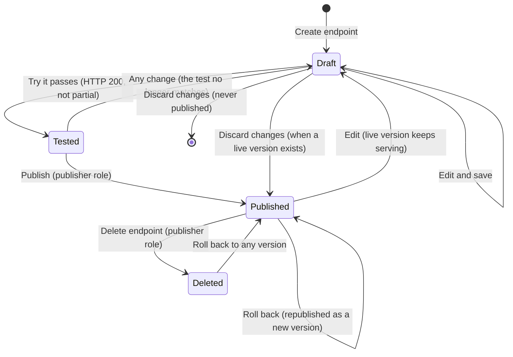

# 04 — Admin UI, lifecycle and OpenAPI import

## In-app help

The admin UI has a **Help** page (`/help`) written for technicians: what to ask a service owner,
which sign-in to pick, how secrets are handled, building and publishing, a troubleshooting table of
every common message, and the error codes apps receive. Each screen links to the matching section.

## Who does what

| Person | Can | Scope in token |
|---|---|---|
| Developer / admin | Register services, set up auth profiles and secret references | `aggregator.author` (profiles and services) |
| QA / technician | Build aggregated endpoints in the wizard, run "Try it", save drafts | `aggregator.author` |
| Approver | Publish and roll back | `aggregator.publisher` |

Technicians **never see credentials**. They pick services that are already set up.

## Lifecycle of an aggregated endpoint

- Drafts live in `config/drafts/` and are **never served**. The live version keeps serving while a
  draft is edited.
- **Publish requires a passing test of the exact draft.** The admin API hashes the recipe content,
  so any change after the test means running it again. You can turn this off with
  `Admin:RequireTestBeforePublish = false`, but don't do that in production.
- Publishing writes `config/recipes/<id>.json` and a history entry `config/history/<id>.v<n>.json`
  (who, when, and the recipe; [ADR 0012](../adr/0012-history-entries-who-when-and-unpublish.md)), then
  removes the draft. The gateway picks it up within `ReloadCheckSeconds` (2 s) with no restart.
- **Version numbers are never reused.** The next version is one more than any version in the history
  or live, and history files are write-once (a clash gives 409).
- **Rollback** republishes an old version's content as a **new** version, so history only ever grows.
  It's refused (400, with the problems) if the old version no longer validates against today's services.
- **Delete endpoint** (publisher) removes the live file, discards the draft and writes
  `<id>.v<n>.unpublished.json`. The gateway stops serving it at its next config check (404
  `not_found`). The history stays, and the endpoint is listed as deleted until it's rolled back or
  published again.
- **Discard changes** removes the draft only.
- **Who** is the caller's `sub` claim. The UI outside Development uses one configured token, so treat
  `by` as advisory until the UI signs users in (roadmap).

## History panel (endpoint editor)

Lists versions newest first: version, what happened (published / rolled back from vN / deleted), when
(UTC), who, and a **live** tag. **View** shows a summary (address, sign-in, steps, combined lists) and
the full JSON, read only. **Roll back to this** and **Delete endpoint** are shown to publishers only
(`canPublish` from `/admin/capabilities`), and each asks for confirmation in plain words. The API
checks the role whatever the UI shows. Entries from before ADR 0012 show "Not recorded" for who and when.

## Services: rename and delete

- **Rename** changes `name` only (through `PUT /admin/services/{id}`). Recipes refer to the id, so
  nothing else changes. Names are 1 to 100 characters, with no control characters.
- **Delete** is refused with 409 while a **published** recipe has a step that calls the service. The
  response, and the UI, name those endpoints. Drafts that use it don't block the delete, but they're
  listed (`GET /admin/services/{id}/usage`). The service's auth profile and secrets are kept,
  because they may be shared.

## Adding a service (Services page → Add service)

| Path | What the user does |
|---|---|
| **From an OpenAPI spec** (recommended) | Paste the spec address and choose **Load**. The name, base address, operations and a suggested sign-in are filled in. Untick operations you don't need, complete the sign-in and save |
| **Enter by hand** | Name and base address, then sign-in. Add endpoints afterwards with **Add endpoint**: method, path (path values such as `{orderId}` are detected), extra query or header values, and optionally a **sample response** so the wizard can offer its fields |

**Sign-in** is picked from cards in plain words: username and password, log in first and reuse the
session, OAuth client (JWT), API key, fixed token, the caller's own token, or none. **Combine with
another sign-in step** chains several. **Check sign-in** logs in or gets a token once, so problems
show up before anyone builds an endpoint.

**Secrets typed in the UI**
- *Development:* saved to `config/secrets.local.json`, which git ignores. The auth profile only
  stores `secret:<service>-<field>`. The gateway and admin API read the file directly whenever it
  has changed (`LocalSecretsResolver`), so a value works on the very next call, including **Check sign-in**.
- *Other environments:* the UI never sends the value. It shows the secret **name** to add in Key
  Vault, and `PUT /admin/secrets/{name}` is refused.

## The wizard

| Screen | What the user does | What keeps it simple |
|---|---|---|
| 1. Endpoint | Name, method, route, sign-in required, scope, cache on/off | The id is generated from the name; the address preview updates as you type |
| 2. Inputs | Caller inputs and their types | Route `{params}` are added automatically; test values sit next to each input |
| 3. Steps | **Add step** opens a searchable list of every service endpoint; pick one | The step is named after the endpoint, and every value is **pre-filled** where a match exists (`AutoBinder`): a same-named input, a same-named field from an earlier step, `<thing>Id` → the id of an earlier step about `<thing>`, or the route value for the first step. Pre-filled values carry a "suggested" tag until changed. "Runs after…" is computed automatically. Advanced (required, when, for each, cache) is hidden by default |
| 4. Response | **Add fields from <step>** in one click, rename or remove; or leave it empty | With no fields, each step's body is returned under its name |
| 5. Test and publish | Try it with test values; see each call's status, time and URL (query values masked); publish | The same validator as the server runs in the browser, so problems show up immediately in plain English |

## OpenAPI import

`POST /admin/services/{id}/openapi/preview` → `POST /admin/services/{id}/openapi/import`

| Step | Detail |
|---|---|
| Source | A spec URL (http/https, no redirects, 10 s timeout, 5 MB cap, optional host allow-list) or pasted text |
| Versions | Swagger 2.0, OpenAPI 3.0, 3.1 (Microsoft.OpenApi 1.6.x), JSON or YAML |
| Pick | The preview lists every operation. You import only the ones you tick |
| Extracted | Method, path, `operationId` (generated if missing), parameters with location and required flag, JSON request and 2xx response schemas (local `$ref`s resolved) |
| Auth hints | `securitySchemes` map to a suggested auth kind: `http/basic` → Basic, `http/bearer` → StaticBearer or PassThrough, `apiKey` → ApiKey, `oauth2`/`openIdConnect` → OAuthClientCredentials |
| Re-import | Endpoints are matched on `operationId`. They're updated, not duplicated, and a manual auth override is kept |

**Services without a spec:** add endpoints by hand in `services.json` or with
`PUT /admin/services/{id}`. To get autocomplete, paste a sample response into
`POST /admin/schema/infer` and store the returned schema as `responseSchema`.

**Gateway spec:** `GET /bff/openapi.json` describes every **published** aggregated endpoint, so web
and mobile teams can generate typed clients (NSwag or Kiota for .NET MAUI, `openapi-typescript`
for web).

How the document is built (`OpenApiDocumentBuilder` in the engine):

- One operation per published recipe, grouped by the first route segment. Inputs become parameters.
- The 200 schema comes from the recipe's response template: each `{{expression}}` is followed through
  the called service's `responseSchema` (properties, `[n]`, slices, `[*]`, `count`, `join`...). Anything
  that can't be worked out for certain is shown as "any value". It never guesses.
- Errors are described once (`Problem`, `ErrorEntry`) and referenced per operation, with the
  correlation id and `Retry-After` headers.
- Internal service names appear only when `Gateway:OpenApi:IncludeInternalDetails` is true (on in
  Development, off otherwise).

**API docs page:** `GET /bff/docs` is Swagger UI (loaded from unpkg.com) over that document, with
Try it out on. In Development it signs itself in with a `/dev/token` test token. Elsewhere testers use
**Authorize** and paste a token. Drafts aren't listed; use **Try it** in the wizard. A recipe whose
route is `docs` or `openapi.json` would be hidden by these two fixed addresses, so avoid those routes.

## Admin API reference

| Method and path | Role | Purpose |
|---|---|---|
| `GET /admin/services`, `PUT /admin/services/{id}` | author | List and save services |
| `GET /admin/services/{id}/usage` | author | Published and draft endpoints that call the service |
| `DELETE /admin/services/{id}` | author | Delete a service. 409 with the endpoint list while a published one uses it |
| `POST /admin/services/{id}/openapi/preview` · `/import` | author | OpenAPI import |
| `GET /admin/capabilities` | author | Whether secrets can be saved here, whether the caller can publish (`canPublish`), and the auth kinds |
| `PUT /admin/secrets/{name}`, `GET /admin/secrets/{name}` | author | Development only: save a secret value; check that one exists (values never come back) |
| `POST /admin/auth-profiles/{id}/check` | author | Sign in once and report the result |
| `GET /admin/auth-kinds` | author | Available auth kinds and their required settings |
| `GET /admin/auth-profiles`, `PUT /admin/auth-profiles/{id}` | author | Profiles (plain-text secrets are rejected) |
| `POST /admin/schema/infer` | author | Sample response → schema |
| `GET /admin/logs?after=&wait=` | author | Recent admin API log lines (long poll). The gateway has the same at `/_admin/logs` |
| `GET /admin/recipes`, `GET/PUT /admin/recipes/{id}` | author | List (including `deleted` endpoints that still have history), read and save drafts |
| `DELETE /admin/recipes/{id}/draft` | author | Discard changes. The live version keeps serving |
| `DELETE /admin/recipes/{id}` | **publisher** | Delete the endpoint: unpublish and discard the draft. History is kept |
| `POST /admin/recipes/{id}/validate` | author | Plain-English issues |
| `GET /admin/recipes/{id}/sources?beforeStep=x` | author | Options for the "use value from" dropdown |
| `POST /admin/recipes/{id}/test` | author | Run the draft (no cache, with trace) |
| `POST /admin/recipes/{id}/publish` | **publisher** | Make it live |
| `GET /admin/recipes/{id}/history` | author | Entries newest first: `version`, `action`, `at`, `by`, `restoredFrom`, `isLive` |
| `GET /admin/recipes/{id}/history/{v}` | author | One version's recipe (read only) |
| `POST /admin/recipes/{id}/rollback/{v}` | **publisher** | Publish version v's content as a new version |
