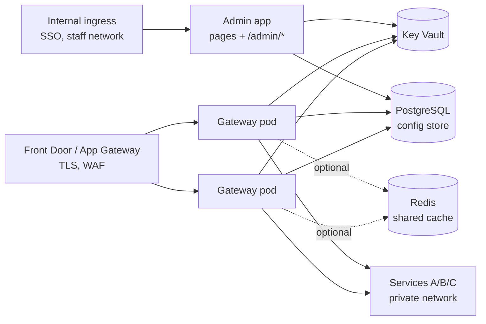

# 05 — Operations, performance and scaling

## Why it's fast

| Technique | Where |
|---|---|
| Independent steps run in parallel; levels come from a plan that's cached per recipe version | `ExecutionPlanner`, `CompositionExecutor` |
| Pooled, reused connections (`SocketsHttpHandler`, 5-minute connection lifetime) | `ServiceCollectionExtensions` |
| `ResponseHeadersRead` and streaming reads with a byte cap | `CompositionExecutor.ReadBodyAsync` |
| Parsed expressions cached; no reflection, no dynamic code | `ValuePath` |
| Config snapshot swapped atomically; zero I/O between reload checks | `FileConfigStore` |
| Route table rebuilt only when the config changes | `RecipeRouter` |
| Downstream sign-in cached with single flight | `DownstreamCredentialCache` |
| Optional response and step caches, bounded memory | `MemoryResponseCache` |

**Measured** while generating the repo: a debug build on one small Linux container shared with the
mock services and the load generator, 32 concurrent clients. These numbers show relative cost only,
not production capacity.

| Scenario | Throughput | p50 | p95 |
|---|---|---|---|
| `customer-overview`, no cache, 6 downstream calls per request | ~480 req/s | 66 ms | 98 ms |
| `customer-profile`, cache on (per caller) | ~2,550 req/s | 10 ms | 27 ms |

Over 3,000 requests the gateway signed in to Services B and C **once each**. With the cache on,
Service A was called **once** for 3,000 requests. Run your own load test with release builds against
real services before sizing (see [06](06-testing.md)).

## Deployment (suggested)

- **Gateway:** stateless, so scale it horizontally (Azure Container Apps or AKS). Each pod has its
  own memory cache and credential cache.
- **Admin app** (pages and `/admin/*`, [ADR 0014](../adr/0014-one-admin-app.md)): low traffic, one replica.
  It changes what the gateway serves, so it **must not share public ingress with the gateway**: give it internal
  ingress only (a staff network or VPN), with SSO in front, in its own network zone where you can. Never route it
  through the gateway's Front Door or WAF endpoint. Outside Development it needs OpenID Connect
  (`Auth:Oidc:*`) and won't start without it.
- **Config store:** the file store suits development and small single-node installs. For several
  gateway pods, use the PostgreSQL store from the roadmap. Until then, mount the same read-only
  config volume into every pod.
- **TLS** terminates at the edge. Keep traffic from the gateway to the services on a private network.
- **Container image:** `Dockerfile` uses the chiseled ASP.NET runtime image, which has no shell and runs as non-root.

## Configuration

| Key | Default | Meaning |
|---|---|---|
| `Aggregator:Config:Directory` | `../../config` | Folder with services, profiles, recipes |
| `Aggregator:Config:ReloadCheckSeconds` | 2 | How quickly published changes go live |
| `Aggregator:Engine:MaxResponseBytes` | 5 MB | Per downstream response |
| `Aggregator:Engine:MaxForEachItems` | 100 | Fan-out cap |
| `Aggregator:Engine:CacheSizeMb` | 256 | Memory for the response and step caches |
| `Gateway:RequestsPerMinutePerCaller` | 600 | Rate limit |
| `Gateway:OpenApi:Enabled` | true | Serves `/bff/openapi.json` (and `/bff/docs`); false gives 404 |
| `Gateway:OpenApi:IncludeInternalDetails` | false | List internal service names in the spec (Development only in practice) |
| `Gateway:ApiDocs:Enabled` | true in Development, else false | Swagger UI page at `/bff/docs` |
| `Gateway:Cors:AllowedOrigins`, `AllowedOriginPatterns`, `PreflightMaxAgeSeconds` | none, none, 600 | Browser access to `/bff/*` ([ADR 0015](../adr/0015-cors-for-the-gateway.md)). The **same values on the gateway and the admin app**; admins add origins within the patterns |
| `Auth:Authority`, `Auth:Audience` | — | Inbound JWT validation |
| `Auth:DevSigningKey` | — | **Development only** |
| `Secrets:<name>` | — | Development secrets. Use Key Vault in production |
| `Admin:RequireTestBeforePublish` | true | Publish gate |
| `Admin:OpenApiAllowedHosts` | [] | Optional import allow-list |

**Request pipeline (gateway):** correlation id → request log → security headers → exception handler → routing →
CORS → authentication → authorization → rate limiter → endpoint. Preflights stop at CORS (204), so they need no
token and don't count towards the rate limit. CORS headers are added as the response starts, so every error keeps
them. The admin app has no CORS middleware.

## Observability

**Correlation.** `X-Correlation-Id` is accepted from callers (letters, digits, `-` and `_`, up to 64
characters) or generated. It's sent to every downstream call, returned on every response including
errors, written into error bodies, and present in every log line through a scope.

**Logs** are structured and source-generated (`EngineLog`), with fixed event IDs. They're JSON
on the console outside Development, ready for Azure Monitor, Seq, Elastic or Loki.

| Event | Level | When | Key fields |
|---|---|---|---|
| 1000 CompositionStarted | Debug | A recipe starts | RecipeId, Version, Subject |
| 1001 CompositionCompleted | Information | It finished with 200 | Status, DurationMs, Steps, FromCache, Partial |
| 1002 CompositionFailed | Warning | 4xx/5xx result | Status, ErrorCode, RootCauses |
| 1003 InputRejected | Information | 400 | ErrorCount (no values) |
| 1100 / 1101 / 1102 | Debug / **Warning** / Debug | Step succeeded / **failed** / skipped | Step, ServiceId, EndpointId, ErrorCode, HttpStatus, DurationMs, Detail |
| 1200 DownstreamAuthFailed | Warning | Sign-in to a service failed | ProfileId, ServiceId, Reason |
| 1201 / 1202 | Information | Credential obtained / invalidated | CacheKey or ProfileId, ExpiresAt or Reason |
| 1300 ResponseCacheHit | Debug | Served from cache | Level, RecipeOrStep |
| 1400 / 1401 | Information / Error | Config loaded / reload failed | Counts, Version |
| 2000 RequestCompleted | Information | Every gateway request | Method, Endpoint (recipe id), Status, DurationMs, CorrelationId, Subject |

**Never logged:** request or response bodies, header values, query values, raw paths, tokens, secret
values. The built-in HttpClient request logging is removed, because it prints full URLs including
query values.

**Live logs in the admin UI.** The **Logs** page shows recent lines from the gateway and the admin
API as they happen, with filters for source, level, text and correlation id
([ADR 0010](../adr/0010-live-logs-in-admin-ui.md)). Each process keeps its last 2,000 lines in
memory (`LiveLogs:Capacity`) and serves them at `/_admin/logs` (gateway) and `/admin/logs` (admin
API) to callers with the `aggregator.author` scope. Set `LiveLogs:Enabled = false` to turn it off.
It shows one process only, so keep a central log store for production.

**Suggested alerts:** a rise in `StepFailed` grouped by ServiceId and ErrorCode; any
`DownstreamAuthFailed`, since expired credentials or rotated secrets are the usual cause;
`ConfigReloadFailed`; p95 of `RequestCompleted.DurationMs` per Endpoint.

**Health:** `/health/live`, and `/health/ready`, which returns the recipe count and config version.

**Next:** OpenTelemetry traces and metrics, with a span per step (roadmap).

## Availability and disaster recovery

- A broken config file never takes the gateway down. It keeps serving the last good snapshot and
  logs an error.
- History plus rollback make a bad publish reversible in seconds.
- Back up the config store (files or PostgreSQL) and Key Vault. The gateway itself has no state.
- Set recovery point and recovery time objectives (RPO/RTO) with the service owners. The aggregator
  is only as available as the **required** steps of each recipe.
