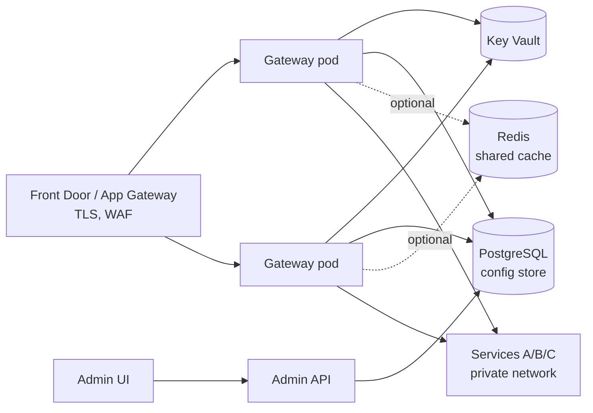

# 05 — Operations, performance and scaling

## Why it's fast

| Technique | Where |
|---|---|
| Independent steps run in parallel; levels come from a plan that's cached per recipe version | `ExecutionPlanner`, `CompositionExecutor` |
| Pooled, reused connections (`SocketsHttpHandler`, 5-minute connection lifetime) | `ServiceCollectionExtensions` |
| `ResponseHeadersRead` and streaming reads with a byte cap | `CompositionExecutor.ReadBodyAsync` |
| Parsed expressions cached; no reflection, no dynamic code | `ValuePath` |
| Config snapshot swapped atomically; zero I/O between reload checks | `FileConfigStore` |
| Route table rebuilt only when the config changes | `RecipeRouter` |
| Downstream sign-in cached with single flight | `DownstreamCredentialCache` |
| Optional response and step caches, bounded memory | `MemoryResponseCache` |

**Measured** while generating the repo: a debug build on one small Linux container shared with the
mock services and the load generator, 32 concurrent clients. These numbers show relative cost only,
not production capacity.

| Scenario | Throughput | p50 | p95 |
|---|---|---|---|
| `customer-overview`, no cache, 6 downstream calls per request | ~480 req/s | 66 ms | 98 ms |
| `customer-profile`, cache on (per caller) | ~2,550 req/s | 10 ms | 27 ms |

Over 3,000 requests the gateway signed in to Services B and C **once each**. With the cache on,
Service A was called **once** for 3,000 requests. Run your own load test with release builds against
real services before sizing (see [06](06-testing.md)).

## Deployment (suggested)

- **Gateway:** stateless, so scale it horizontally (Azure Container Apps or AKS). Each pod has its
  own memory cache and credential cache.
- **Admin API / UI:** low traffic, one replica, internal network only, behind SSO.
- **Config store:** the file store suits development and small single-node installs. For several
  gateway pods, use the PostgreSQL store from the roadmap. Until then, mount the same read-only
  config volume into every pod.
- **TLS** terminates at the edge. Keep traffic from the gateway to the services on a private network.
- **Container image:** `Dockerfile` uses the chiseled ASP.NET runtime image, which has no shell and runs as non-root.

## Configuration

| Key | Default | Meaning |
|---|---|---|
| `Aggregator:Config:Directory` | `../../config` | Folder with services, profiles, recipes |
| `Aggregator:Config:ReloadCheckSeconds` | 2 | How quickly published changes go live |
| `Aggregator:Engine:MaxResponseBytes` | 5 MB | Per downstream response |
| `Aggregator:Engine:MaxForEachItems` | 100 | Fan-out cap |
| `Aggregator:Engine:CacheSizeMb` | 256 | Memory for the response and step caches |
| `Gateway:RequestsPerMinutePerCaller` | 600 | Rate limit |
| `Auth:Authority`, `Auth:Audience` | — | Inbound JWT validation |
| `Auth:DevSigningKey` | — | **Development only** |
| `Secrets:<name>` | — | Development secrets. Use Key Vault in production |
| `Admin:RequireTestBeforePublish` | true | Publish gate |
| `Admin:OpenApiAllowedHosts` | [] | Optional import allow-list |

## Observability

- **Health:** `/health/live`, and `/health/ready`, which returns the recipe count and config version.
- **Correlation:** `X-Correlation-Id` is accepted from callers (validated) or generated, sent to every
  downstream call and returned on the response.
- **Logs:** one structured audit line per composition, with no values. Downstream auth failures are
  logged as warnings without secrets.
- **Next:** OpenTelemetry traces and metrics, with a span per step and counters for cache hits and
  sign-ins (roadmap).

## Availability and disaster recovery

- A broken config file never takes the gateway down. It keeps serving the last good snapshot and
  logs an error.
- History plus rollback make a bad publish reversible in seconds.
- Back up the config store (files or PostgreSQL) and Key Vault. The gateway itself has no state.
- Set recovery point and recovery time objectives (RPO/RTO) with the service owners. The aggregator
  is only as available as the **required** steps of each recipe.
