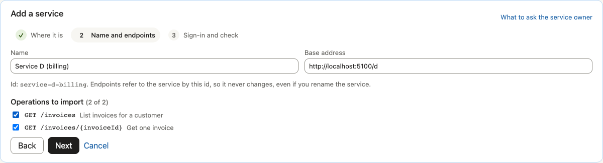
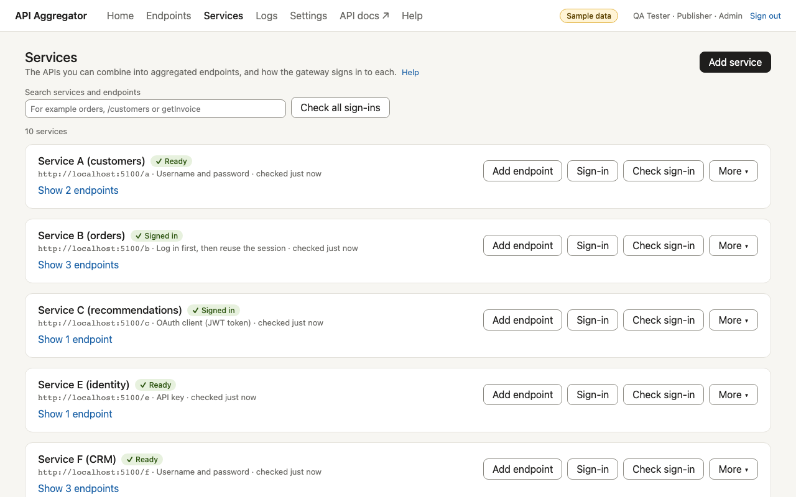

# Adding services

**For:** technicians and QA, and the developer or admin who sets up sign-ins.

A **service** is a backend API the gateway calls, such as customers, orders or billing. You add each
service once: its address, its endpoints, and how the gateway signs in to it. After that, anyone can
use its endpoints as steps when [building endpoints](building-endpoints.md).

The examples use the mock services from [Getting started](getting-started.md) (`./scripts/dev-run.sh`).

## Before you start: what to ask the service owner

The owner is the team that runs the service. Ask them for:

| What | Example | Why |
|---|---|---|
| The OpenAPI (Swagger) spec address, if there is one | `https://billing.internal/swagger/v1/swagger.json` | Fills in the endpoints and their fields for you |
| The base address for the **test** environment | `https://billing-test.internal/api` | Where calls go while you build |
| How to sign in, and test credentials | "API key in the `X-Api-Key` header" | See [Pick the sign-in](#pick-the-sign-in) |
| An example request (curl or a Postman collection) | `curl -H "X-Api-Key: ..." .../invoices?customerId=C-1` | The headers show which sign-in it is |
| A test record you may use | Customer `C-10042` | For **Try it** |
| Rate limits, and whether calls cost money | "100 calls a minute" | So you don't overload it while testing |

Use test environments and test data while building. Never paste real customer or patient data into
test values or sample responses.

## Add a service from its OpenAPI spec (recommended)

This walk-through adds **Service D (billing)**, which is in the mocks but not in any configuration yet.
It works in sample mode and in real mode.

1. Go to **Services** and choose **Add service**.
2. Keep **From an OpenAPI spec** selected, paste `http://localhost:5100/d/openapi.json` and choose **Load**.
3. Check what was filled in: **Name** `Service D (billing)` and **Base address** `http://localhost:5100/d`.
   Change the address if the spec points at the wrong environment.
4. Untick any operations you don't need. Keep both here: *List invoices for a customer* and *Get one invoice*.
5. The spec says it uses an API key, so **API key** is already picked. Enter **Key name** `X-Api-Key`,
   keep **Send it in** as `header`, and type the **Key value** `key-d`.
6. Choose **Save service**. The gateway checks the sign-in straight away, and the result appears next to
   the service name.



The **base address** is the part every endpoint path is added to. If calls look like
`https://billing.internal/api/invoices`, the base address is `https://billing.internal/api` and the
endpoint path is `/invoices`.

Later, **Import from OpenAPI** on the service brings in new operations. Endpoints already imported are
updated in place, matched by their operation id, so steps that use them keep working.

The admin UI tests (`tests/ApiAggregator.UI.Tests`) run this walk-through in a real browser.

## Add a service by hand (no spec)

1. **Services** → **Add service** → **Enter by hand**. Enter the name and base address, pick the sign-in, and save.
2. On the service, choose **Add endpoint** for each operation you need:

| Field | Example | Tip |
|---|---|---|
| Name | Get order lines | Shown when building endpoints. Make it an action |
| Method | `GET` | As the service documents it |
| Path | `/orders/{orderId}/lines` | Put the parts that change in braces. They become required path values |
| Other values | `status` (query), `X-Customer-Id` (header) | Tick **Required** if the service rejects calls without it |
| Sample response | `{ "orderId": "O-1", "lines": [ { "sku": "SKU-1", "qty": 1 } ] }` | Paste a realistic answer with invented data. The wizard then offers these fields in its dropdowns |

In the files, that endpoint looks like this ([`samples/config/services.json`](../../samples/config/services.json)):

```json
{
  "id": "getOrderLines",
  "method": "GET",
  "path": "/orders/{orderId}/lines",
  "parameters": [ { "name": "orderId", "in": "path", "required": true, "type": "string" } ]
}
```



## Pick the sign-in

Pick the card that matches what the owner told you:

| The owner says… | Card in the UI | `kind` in the file | You'll need |
|---|---|---|---|
| "No auth, it's internal" | No sign-in | (no profile) | Nothing |
| "Basic auth" | Username and password | `Basic` | Username, password |
| "Call /login first, then use the cookie" or "the login returns a token" | Log in first, then reuse the session | `SessionLogin` | Login address, username, password, and where the token is in the answer (if any) |
| "OAuth 2.0 client credentials", "Entra ID app registration" | OAuth client (JWT token) | `OAuthClientCredentials` | Token address, client id, client secret, scope |
| "Send an API key", "subscription key" | API key | `ApiKey` | Key name, value, header or query |
| "Here's a long-lived token" | Fixed token | `StaticBearer` | The token |
| "We accept your users' own tokens" | Use the caller's own token | `PassThroughUserToken` | Nothing, but only when the owner confirms it |

**Two at once** (for example an API key *and* a login): pick the first card, then choose **Combine
with another sign-in step**.

After saving, **Check sign-in** logs in or gets a token once, so you find problems before anyone builds an
endpoint. For Basic, API key and fixed token there's nothing to log in to, so the check only confirms
the settings are complete. A real call, with **Try it**, proves them.

Sign-ins are stored in `auth-profiles.json`. Each example below is the real sample profile
([`samples/config/auth-profiles.json`](../../samples/config/auth-profiles.json)) and a checked run
that uses it.

### Basic: Service A (customers)

```json
{
  "id": "service-a-basic",
  "steps": [ { "kind": "Basic", "settings": { "username": "svc-a", "password": "secret:service-a-password" } } ]
}
```

The gateway sends `Authorization: Basic …` on every call. `customer-profile` uses it:

<!-- check: run customer-profile --route id=C-10042 -->
```json
{
  "id": "C-10042",
  "name": "Alex Example",
  "addresses": [ { "type": "home", "suburb": "Carlton", "state": "VIC", "postcode": "3053" } ]
}
```

### Login session: Service B (orders)

```json
{
  "id": "service-b-session",
  "steps": [ {
    "kind": "SessionLogin",
    "settings": {
      "loginUrl": "http://localhost:5100/b/auth/login",
      "username": "svc-b", "password": "secret:service-b-password",
      "format": "json", "ttlSeconds": "900"
    }
  } ]
}
```

The gateway posts `{ "username": "svc-b", "password": "…" }` to the login address once, keeps the
session cookie for 15 minutes (`ttlSeconds`), and sends it on every call. If the service answers 401, it
logs in again and retries once. When 200 requests arrive together with an expired session, it logs in
**once**, not 200 times.

- The login returns a **token** instead of a cookie: set **Token in the login response**
  (`tokenPath`), for example `token` or `data.accessToken`. Service K does this (see [Combined](#combined-service-k-appointments)).
- The login wants a **form** instead of JSON: set **Send login as** (`format`) to `form`.
- The login itself uses **Basic**: under the advanced settings, set **Log in with Basic auth instead of a body** (`loginUsesBasic`) to `true`.

### OAuth client credentials (JWT): Service C (recommendations)

```json
{
  "id": "service-c-oauth",
  "steps": [ {
    "kind": "OAuthClientCredentials",
    "settings": {
      "tokenUrl": "http://localhost:5100/c/oauth/token",
      "clientId": "client-c", "clientSecret": "secret:service-c-client-secret"
    }
  } ]
}
```

The gateway gets an access token from the token address, keeps it until 60 seconds before it expires,
and sends `Authorization: Bearer <token>`. Add `scope` or `audience` if the owner gives you one.
Services B and C both sign in during one `customer-overview` call:

<!-- check: run customer-overview --route id=C-10042 -->
```text
Succeeded a          200     37 ms  calls=1  GET http://localhost:5100/a/customers/C-10042
Succeeded b          200     19 ms  calls=1  GET http://localhost:5100/b/orders?account=…&status=…&page=…
Succeeded c          200      7 ms  calls=1  GET http://localhost:5100/c/recommendations?segment=…
```

### API key: Service E (identity)

```json
{
  "id": "service-e-apikey",
  "steps": [ { "kind": "ApiKey", "settings": { "name": "X-Api-Key", "value": "secret:service-e-api-key" } } ]
}
```

Sends `X-Api-Key: …` on every call. Add `"in": "query"` if the key goes in the address instead.
Services E and G use it in `people-directory`:

<!-- check: run people-directory -->
```text
Succeeded identity   200     33 ms  calls=1  GET http://localhost:5100/e/users
Succeeded crm        200     24 ms  calls=1  GET http://localhost:5100/f/contacts
Succeeded billing    200     23 ms  calls=1  GET http://localhost:5100/g/accounts
Succeeded links      200     23 ms  calls=1  GET http://localhost:5100/h/links
```

Service H (links) has no sign-in at all: it's "internal" in the sample. Only do that when the owner
confirms the service is on a private network.

### Fixed token: Service I (loyalty)

```json
{
  "id": "service-i-token",
  "steps": [ { "kind": "StaticBearer", "settings": { "token": "secret:service-i-token" } } ]
}
```

Sends `Authorization: Bearer <token>`. Set `header` to use another header name. Ask the owner when the
token expires, and put a reminder in your calendar to [rotate it](operations.md#rotating-secrets).

<!-- check: run customer-loyalty --route id=C-10042 -->
```json
{ "customerId": "C-10042", "points": 1250, "tier": "gold" }
```

### The caller's own token: Service J (preferences)

```json
{ "id": "service-j-caller", "steps": [ { "kind": "PassThroughUserToken", "settings": {} } ] }
```

The token the app sent to the gateway is passed on to the service. **This is the only sign-in that does
that.** Every other kind keeps the app user's token away from services. Use it only when the owner
confirms their service trusts the same identity provider and audience as the gateway.

Through the gateway, with a token for user `dev-user`:

<!-- check: gateway GET /bff/me/preferences scope=profile.read -->
```json
{ "subject": "dev-user", "language": "en-AU", "contactBy": "email" }
```

Without a caller (the command line has no token unless you pass `--token`), the gateway can't sign in:

<!-- check: run my-preferences expect=502 -->
```json
{
  "type": "urn:api-aggregator:error:auth_failed",
  "title": "The gateway couldn't authenticate with a required service.",
  "status": 502,
  "code": "auth_failed",
  "detail": "Get my preferences: The gateway couldn't sign in to Service J (preferences).",
  "correlationId": "f2a903d8dc8f4259a4306188818030ad",
  "retryable": false,
  "errors": [
    {
      "step": "prefs",
      "name": "Get my preferences",
      "service": "service-j-preferences",
      "code": "auth_failed",
      "status": null,
      "message": "The gateway couldn't sign in to Service J (preferences).",
      "retryable": false
    }
  ]
}
```

### Combined: Service K (appointments)

Service K wants an API key **and** a token from its login. Steps run in order and each adds its part:

```json
{
  "id": "service-k-key-and-login",
  "steps": [
    { "kind": "ApiKey", "settings": { "name": "X-Api-Key", "value": "secret:service-k-api-key" } },
    {
      "kind": "SessionLogin",
      "settings": {
        "loginUrl": "http://localhost:5100/k/auth/login",
        "username": "svc-k", "password": "secret:service-k-password",
        "format": "json", "tokenPath": "token", "ttlSeconds": "900"
      }
    }
  ]
}
```

<!-- check: run customer-appointments --route id=C-10042 -->
```json
{
  "customerId": "C-10042",
  "appointments": [
    { "id": "AP-1", "date": "2026-12-02", "time": "09:30", "type": "review" },
    { "id": "AP-2", "date": "2027-01-15", "time": "14:00", "type": "follow-up" }
  ],
  "count": 2
}
```

Other common combinations: "Basic login → session + API key" is `ApiKey` plus `SessionLogin` with
`loginUsesBasic: "true"`. "Login → JWT → Bearer" is `SessionLogin` with `tokenPath`.

### Taking a sign-in away, or one that doesn't exist

Choosing **No sign-in** for a service that published endpoints call shows which ones, before you save:
without credentials, a service that needs them answers 401 to every call. A service or endpoint that names a
sign-in that doesn't exist is never called without credentials instead: the admin app refuses to save it,
**Check before publishing** and `aggregator validate` report it, and if it still happens the step fails with
`auth_failed`.

## Secrets

Passwords, keys, client secrets and tokens are **never** stored in `auth-profiles.json`. The file holds
only a reference such as `secret:service-a-password`. The admin app refuses a profile that holds a plain
value.

| Where you are | When you type a secret in the UI | Where the gateway finds it |
|---|---|---|
| **Development** (your computer) | Saved to `secrets.local.json` in the config folder. Git ignores it. It works on the very next call | `secrets.local.json`, or a `Secrets:<name>` setting: user-secrets, an environment variable `Secrets__<name>`, or `appsettings.Development.json` (the mock passwords are there) |
| **Test and production** | Not saved. The UI shows the secret's **name** for an administrator to add | Azure Key Vault (see below) |

Password boxes never show a saved value again. "Saved. Type to replace" means one is stored.

**Key Vault.** Built-in Key Vault support is on the [roadmap](../roadmap.md). Until it lands, an
administrator can load secrets with the standard Key Vault configuration provider and managed identity.
That provider turns the Key Vault secret `Secrets--service-a-password` into the setting
`Secrets:service-a-password`. See [Operations](operations.md#secrets-and-key-vault).

Never send secrets in chat, email or tickets. Send the secret's **name**, and let the administrator get
the value from the service owner.

## Rename or delete a service

- **Rename** changes only the name people see. The id stays the same, so endpoints keep working.
- **Delete** is refused while a **published** endpoint uses the service, and the page lists which ones.
  Drafts that use it are listed but don't block it.
- The service's sign-in and secrets are kept, because another service may share them.

## When something's wrong

Next to each service name, a status pill shows the last sign-in check: **Signed in**, **Ready** (settings
complete; Basic, API key and fixed token), **Not checked**, **Failed** or **No sign-in**. Hover over it for
the reason. [Troubleshooting](troubleshooting.md#sign-in-problems) lists every message and what to do.
The design behind sign-ins is in [architecture 03](../architecture/03-auth-and-security.md).
