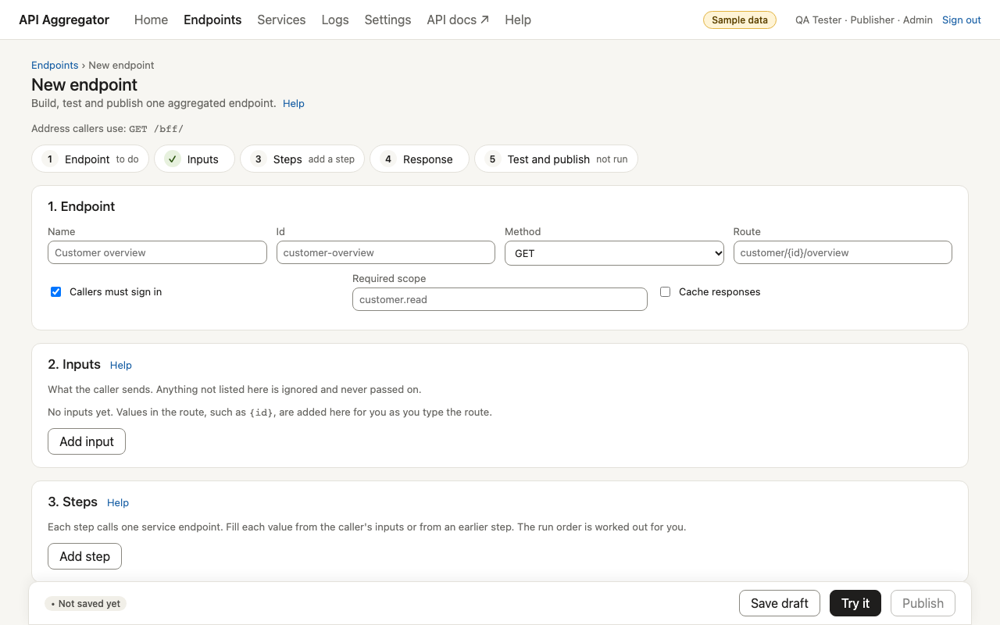
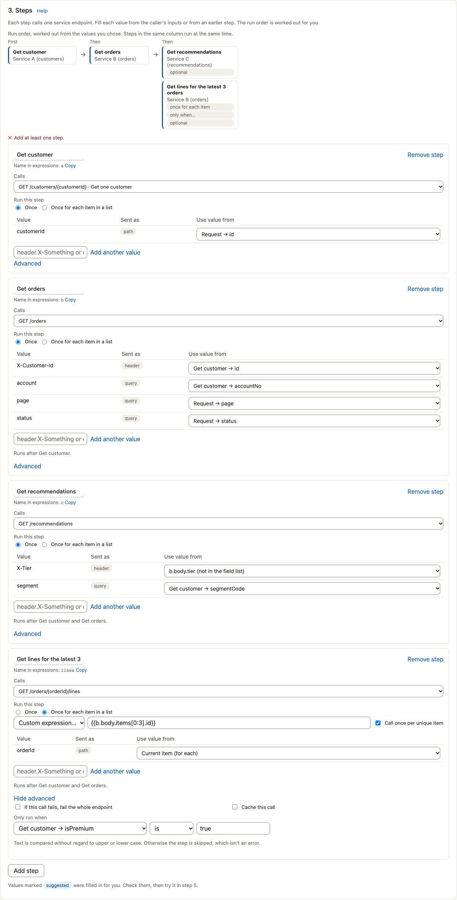
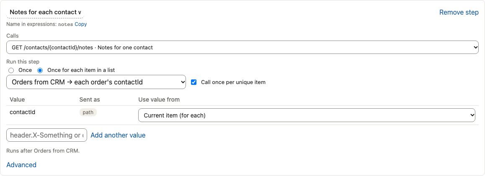

# Building endpoints

**For:** technicians and QA.

An **aggregated endpoint** is what apps call, for example `GET /bff/customer/C-10042/summary`. Behind
it, the gateway runs **steps**. Each step calls one service endpoint, can use values from the caller and
from earlier steps, and the answers are put together into one **response**. No code is involved: you
build it in the wizard, and it's saved as a JSON file called a *recipe*.

Every example on this page is a real recipe in [`samples/config/recipes/`](../../samples/config/recipes/),
and every response shown is checked against the mock services by `scripts/check-docs.sh`. You can run any
of them yourself:

```bash
./scripts/dev-run.sh      # in one terminal
env "Secrets__service-a-password=pass-a" "Secrets__service-b-password=pass-b" "Secrets__service-c-client-secret=secret-c" "Secrets__service-i-token=token-i" \
  dotnet run --project tools/ApiAggregator.Cli -- run customer-summary --route id=C-10042 --config samples/config
```

Or open the endpoint in the admin UI and choose **Try it**.

## The wizard in five steps

Go to **Endpoints** and choose **Create endpoint**.



| Step | What you do | Tip |
|---|---|---|
| **1. Endpoint** | Name, method, route, **Callers must sign in**, **Required scope**, **Cache responses** | The address preview shows what apps will call: route `customer/{id}/summary` becomes `/bff/customer/C-10042/summary` |
| **2. Inputs** | What callers may send: route values, query values, headers | Route values like `{id}` are added for you. Put a test value next to each input for **Try it** |
| **3. Steps** | **Add step**, search, pick a service endpoint. Fill each value from **Use value from** | Values marked *suggested* were filled in for you. Check each one |
| **4. Response** | **Add fields from …** for each step, then rename or remove fields | Leave it empty to return each step's whole answer |
| **5. Test and publish** | Fix anything under **Things to fix**, choose **Try it**, then **Publish** | Publishing needs a passing test of exactly what you're publishing |

Problems are shown next to the field they're about, as you type. The footer keeps **Save draft**,
**Try it** and **Publish** in reach, and the page warns you before you leave with unsaved changes.

## Passing values between calls

`customer-summary` gets a customer from **Service A**, then passes values from A's answer to three other
services, each in a different place:

| Step | Service endpoint | Value | Goes into |
|---|---|---|---|
| `customer` | A: `GET /customers/{customerId}` | the caller's `{id}` | the **path** |
| `loyalty` | I: `GET /loyalty/{customerId}` | A's `id` | the **path** |
| `orders` | B: `POST /orders/search` | A's `id`, and the caller's `status` | the **body** (JSON) |
| `offers` | C: `GET /recommendations` | A's `segmentCode`, and **I's** `tier` | a **query** value and a **header** |

The last step, `offers`, uses values from two earlier steps. The gateway works out the order on its own:
`customer` first, then `loyalty` and `orders` at the same time (neither needs the other), then `offers`.
The wizard draws this as lanes under **Steps**, and each step says what it **runs after**.



The recipe ([`customer-summary.json`](../../samples/config/recipes/customer-summary.json)):

```json
"steps": [
  { "alias": "customer", "endpoint": "service-a/getCustomer",
    "bind": [ { "from": "request.route.id", "to": "path.customerId" } ] },

  { "alias": "loyalty", "endpoint": "service-i-loyalty/getLoyalty", "required": false,
    "bind": [ { "from": "customer.body.id", "to": "path.customerId" } ] },

  { "alias": "orders", "endpoint": "service-b/searchOrders",
    "bind": [ { "template": { "customerId": "{{customer.body.id}}", "status": "{{request.query.status}}" }, "to": "body" } ] },

  { "alias": "offers", "endpoint": "service-c/getRecommendations", "required": false,
    "bind": [
      { "from": "customer.body.segmentCode", "to": "query.segment" },
      { "from": "loyalty.body.tier",         "to": "header.X-Tier" }
    ] }
],
"response": {
  "name": "{{customer.body.name}}",
  "points": "{{loyalty.body.points}}",
  "tier": "{{loyalty.body.tier}}",
  "orderStatus": "{{orders.body.status}}",
  "orderIds": "{{orders.body.items[*].id}}",
  "offers": "{{offers.body.items[*].title}}"
}
```

The calls it makes, and the answer:

<!-- check: run customer-summary --route id=C-10042 -->
```text
Succeeded customer   200     31 ms  calls=1  GET http://localhost:5100/a/customers/C-10042
Succeeded loyalty    200      2 ms  calls=1  GET http://localhost:5100/i/loyalty/C-10042
Succeeded orders     200      8 ms  calls=1  POST http://localhost:5100/b/orders/search
Succeeded offers     200      2 ms  calls=1  GET http://localhost:5100/c/recommendations?segment=…
```

<!-- check: run customer-summary --route id=C-10042 -->
```json
{
  "name": "Alex Example",
  "points": 1250,
  "tier": "gold",
  "orderStatus": "open",
  "orderIds": ["O-042-1", "O-042-2", "O-042-3"],
  "offers": ["Offer for family/gold", "Loyalty bonus"]
}
```

With another customer and `?status=closed`, the same recipe sends different values everywhere:

<!-- check: run customer-summary --route id=C-20001 --query status=closed -->
```json
{
  "name": "Sam Sample",
  "points": 80,
  "tier": "standard",
  "orderStatus": "closed",
  "orderIds": ["O-001-1", "O-001-2", "O-001-3"],
  "offers": ["Offer for single/standard", "Loyalty bonus"]
}
```

### Where values can come from

In the wizard this is the **Use value from** list. In the recipe it's `from`, or `{{ }}` inside a template.

| Source | Example | Meaning |
|---|---|---|
| A caller input | `request.route.id`, `request.query.status`, `request.header.X-Tenant` | Only declared inputs (step 2) |
| The caller's sign-in | `request.claims.sub` | A claim from the app user's token |
| An earlier step | `customer.body.id`, `orders.headers['X-Total']`, `orders.status` | Its answer, headers or HTTP status |
| Inside "run for each" | `item`, `index` | The current item, and its position |
| A fixed value | **Fixed value…** in the list | The same every time |

**Picking parts of an answer:** `items[0]` (first), `items[-1]` (last), `items[0:5]` (first five),
`items[*].id` (every id), and transforms after a `|`: `count`, `first`, `last`, `join(',')`,
`default('n/a')`, `upper`, `lower`, `trim`, `string`, `distinct`, `distinct('id')`. That's the whole
list. There's no scripting, on purpose ([ADR 0002](../adr/0002-declarative-recipes-no-scripting.md)).

### Where values can go

`path.<name>`, `query.<name>`, `header.<Name>`, `cookie.<name>`, `body` (a whole JSON template) or
`body.<field>`. Each value is escaped for where it goes, so a value can't change the address or add a
header. `Authorization`, `Cookie`, `Host` and a few other headers can't be set this way, because the
service's [sign-in](adding-services.md#pick-the-sign-in) handles them.

## Inputs and validation

Apps can send **only** what you declare in step 2. Anything else, such as an extra `?admin=true`, is
ignored and never reaches a service.

```json
"inputs": {
  "route.id":     { "type": "string", "required": true, "pattern": "^C-[0-9]{5}$" },
  "query.status": { "type": "string", "enum": ["open", "closed"], "default": "open" }
}
```

| Setting | Example | Effect |
|---|---|---|
| `type` | `string`, `int`, `number`, `bool`, `date` | `int` accepts `3`, refuses `three` |
| `required` | `true` | Route values are always required |
| `pattern` | `^C-[0-9]{5}$` | `C-10042` passes, `10042` doesn't |
| `enum` | `["open", "closed"]` | Only these values |
| `min`, `max` | `1`, `100` | For numbers |
| `default` | `"open"` | Used when the caller doesn't send it |
| `maxLength` | `40` | 200 if not set |

A wrong value is refused before any service is called, with a message the app can show:

<!-- check: run customer-summary --route id=10042 expect=400 -->
```json
{
  "type": "urn:api-aggregator:error:invalid_input",
  "title": "Some inputs are missing or invalid.",
  "status": 400,
  "code": "invalid_input",
  "correlationId": "d6b1b297f6424383929a2927aa2f3f9b",
  "errors": [ { "code": "invalid_input", "message": "'id' is not in the expected format." } ]
}
```

<!-- check: run customer-overview --route id=C-10042 --query page=500 expect=400 -->
```json
{
  "type": "urn:api-aggregator:error:invalid_input",
  "title": "Some inputs are missing or invalid.",
  "status": 400,
  "code": "invalid_input",
  "correlationId": "cbbb3bda52e5412bbc680ff393e6be74",
  "errors": [ { "code": "invalid_input", "message": "'page' must be at most 100." } ]
}
```

## Optional steps: nice-to-have data

Under a step's **Advanced** settings, untick **If this call fails, fail the whole endpoint**
(`"required": false`) for data the app can do without. Then a failure gives a **200** with what worked,
plus `_errors`.

Customer `C-30003` is new and has no loyalty membership, so Service I answers 404:

<!-- check: run customer-summary --route id=C-30003 -->
```text
--- run 1: HTTP 200 in 48 ms (partial)
    Succeeded customer   200     30 ms  calls=1  GET http://localhost:5100/a/customers/C-30003
    Failed    loyalty    404      2 ms  calls=1    Service I (loyalty) answered 404. [not_found]
    Succeeded orders     200      7 ms  calls=1  POST http://localhost:5100/b/orders/search
    Failed    offers     -        0 ms  calls=0    Not run because 'loyalty' failed. [dependency_failed]
```

<!-- check: run customer-summary --route id=C-30003 -->
```json
{
  "name": "Jo Trial",
  "points": null,
  "tier": null,
  "orderStatus": "open",
  "orderIds": ["O-003-1", "O-003-2", "O-003-3"],
  "offers": [],
  "_errors": [
    {
      "step": "loyalty",
      "name": "Get loyalty (customer id in the path)",
      "service": "service-i-loyalty",
      "code": "not_found",
      "status": 404,
      "message": "Service I (loyalty) answered 404.",
      "retryable": false
    }
  ]
}
```

Things to notice:

- `offers` needs the loyalty `tier`, so it **isn't run**. Only the root cause (`loyalty`) is in `_errors`.
- Values from a step that failed or didn't run come back as `null`, or an empty list for `[*]` paths.
- If a **required** step fails, the whole call fails with **502**. Here customer `C-99999` doesn't exist:

<!-- check: run customer-overview --route id=C-99999 expect=502 -->
```json
{
  "type": "urn:api-aggregator:error:not_found",
  "title": "A required service call failed.",
  "status": 502,
  "code": "not_found",
  "detail": "Get customer: Service A (customers) answered 404.",
  "correlationId": "a8881dd0a08b4418a3d9bdfd5c4a7750",
  "retryable": false,
  "errors": [
    {
      "step": "a",
      "name": "Get customer",
      "service": "service-a",
      "code": "not_found",
      "status": 404,
      "message": "Service A (customers) answered 404.",
      "retryable": false
    }
  ]
}
```

What apps should do with each code is in [For app developers](for-app-developers.md#error-codes).

## Conditions: only run when…

**Only run when** is under a step's **Advanced**. It skips the step unless a value from the caller or an
earlier step is what you say. Pick it in three parts:

**Only run when** [ value ▾ ] [ **is** / **is not** / **has a value** ▾ ] [ text ]


| You pick | Runs when |
|---|---|
| `Get customer → isPremium` **has a value** | `isPremium` is there and isn't empty, `false` or `0` |
| `Get customer → isPremium` **is** `true` | `isPremium` is `true` |
| `Get customer → status` **is** `active` | `status` is `active` (upper or lower case doesn't matter) |
| `Get customer → status` **is not** `closed` | `status` is anything but `closed` |

A skipped step isn't an error. `customer-overview` gets order lines only for premium customers, and
`C-20001` isn't premium:

<!-- check: run customer-overview --route id=C-20001 -->
```text
Succeeded a          200     31 ms  calls=1  GET http://localhost:5100/a/customers/C-20001
Succeeded b          200      7 ms  calls=1  GET http://localhost:5100/b/orders?account=…&status=…&page=…
Succeeded c          200      2 ms  calls=1  GET http://localhost:5100/c/recommendations?segment=…
Skipped   lines      -        0 ms  calls=0    Condition not met.
```

**Custom condition…** is for anything the picker can't say, such as comparing two values. You type the
condition in the recipe's own form, using the step's **name in expressions** (see
[Renaming a step](#renaming-a-step)):

| Custom condition | Runs when |
|---|---|
| `{{a.body.isPremium}}` | `isPremium` has a value (the same as **has a value**) |
| `{{a.body.isPremium}} == true` | `isPremium` is `true` (the same as **is**) |
| `{{a.body.status}} != closed` | `status` isn't `closed` (the same as **is not**) |

Saved conditions open in the picker when it can show them, and in **Custom condition…** with their text
kept otherwise.

## Run for each item

A step can call its service **once for each item in a list** from an earlier step, for example the notes
of each contact who has an order. Under the step's name, choose **Run this step: Once for each item in a
list**, then pick the list. The dropdown lists, in plain words, every list in the earlier steps' answers
and every field inside one:

| You pick | The step runs once for each… |
|---|---|
| `Orders from CRM → each order` | order (a whole record) |
| `Orders from CRM → each order's contactId` | `contactId` of an order |

Then choose **Current item** for the value the service needs. When a value has the same name as the
looped field, it's filled in for you and marked *suggested*: `contactId` ← **Current item**. When the loop
is over whole records (**each order**), pick **Current item → contactId** instead. If you choose **Current
item** before picking a list, the wizard says **Choose what to loop over first**.

### Worked example: notes for each contact with an order

`contacts-unique` ([recipe](../../samples/config/recipes/contacts-unique.json)) has three steps, all on
the CRM:

1. **Contacts from CRM** calls `GET /contacts`.
2. **Orders from CRM** calls `GET /orders`. There are 6 orders.
3. **Notes for each contact with an order** calls `GET /contacts/{contactId}/notes`, with **Run this
   step: Once for each item in a list** → `Orders from CRM → each order's contactId`, **Call once per
   unique item** ticked, and `contactId` ← **Current item**.



The 6 orders belong to 3 contacts, so with **Call once per unique item** the step calls the service
**3** times, not 6:

<!-- check: run contacts-unique -->
```text
Succeeded notes      200      3 ms  calls=3  GET http://localhost:5100/f/contacts/c-101/notes
```

<!-- check: run contacts-unique partial -->
```json
{ "orderCount": 6, "notesCalls": 3 }
```

In step 4, **Add fields from Notes for each contact with an order** takes each field *from every call*:
the step's result is a list with one answer per call.

### Good to know

- **Custom expression…** keeps a text box for lists the dropdown doesn't offer. For example,
  `customer-overview` fetches order lines for **only the first three** orders:
  `{{b.body.items[0:3].id}}`. Saved loops open in the dropdown when they match an option, and in
  **Custom expression…** otherwise.
- At most 4 calls run at the same time (`maxConcurrency` in the recipe; `contacts-unique` uses 3), and at
  most 100 items per step.
- Repeated items are called **once**. Untick **Call once per unique item** only if the same call really
  must be repeated. [Combine lists](combine-lists.md#duplicates-inside-one-list) says more about duplicates.

`customer-overview`'s `lines` step runs for each of the first three orders of a premium customer:
`calls=3`. Its response uses `"orderLines": "{{lines[*].body}}"`:

<!-- check: run customer-overview --route id=C-10042 -->
```text
Succeeded lines      200      4 ms  calls=3  GET http://localhost:5100/b/orders/O-042-1/lines
```

<!-- check: run customer-overview --route id=C-10042 partial -->
```json
{
  "customer": { "id": "C-10042", "name": "Alex Example", "segment": "family" },
  "tier": "gold",
  "orderCount": 7,
  "orderLines": [
    { "orderId": "O-042-1", "lines": [ { "sku": "SKU-1", "qty": 1 }, { "sku": "SKU-2", "qty": 3 } ] },
    { "orderId": "O-042-2", "lines": [ { "sku": "SKU-1", "qty": 1 }, { "sku": "SKU-2", "qty": 3 } ] },
    { "orderId": "O-042-3", "lines": [ { "sku": "SKU-1", "qty": 1 }, { "sku": "SKU-2", "qty": 3 } ] }
  ],
  "recommendations": [ { "code": "R1", "title": "Offer for family/gold" }, { "code": "R2", "title": "Loyalty bonus" } ]
}
```

## Renaming a step

Every step has a **name in expressions**, shown small under its name, for example *Name in expressions:
getOrders*, with a **Copy** button. The pickers use it for you. You only need it to write a **Custom**
expression or condition.

- While nothing uses the step, its name in expressions follows its display name: "Orders from CRM"
  becomes `ordersFromCrm`. Nothing is asked.
- Once something uses it, changing the display name asks **Also rename it to ordersFromCrm in
  expressions? 3 places in this endpoint use it.** **Rename everywhere** updates every value, condition,
  list, response field and combined list that uses it. **Keep getOrders** changes only the display name.
- On a **live** endpoint it always asks, because apps see the name: in error details (`errors[].step`
  and `_errors[].step`), and, when the endpoint has no response fields, as a field name in the answer.
  Apps [should act on `code`, not `step`](for-app-developers.md#errors). Nothing changes for apps until
  you publish.
- A name that another step already has, or a reserved word (`request`, `item`, `index`, `ctx`,
  `combine`), is refused with a message saying so.

If an expression uses a name that isn't a step, **Things to fix** suggests the closest one: *'ordersFromCrm'
isn't a step here. Did you mean 'getOrders' (Orders from CRM)?*

## Caching

Caching is **off** unless you turn it on. **Cache responses** in step 1 keeps the whole answer;
**Cache this call** under a step's **Advanced** keeps one service's answer.

```json
"cache": { "enabled": true, "ttlSeconds": 30, "perCaller": true }
```

`customer-profile` caches for 30 seconds. Run it twice: the second answer comes from the cache in 0 ms and
no service is called.

```bash
dotnet run --project tools/ApiAggregator.Cli -- run customer-profile --route id=C-10042 --repeat 2 --config samples/config
```

<!-- check: run customer-profile --route id=C-10042 --repeat 2 -->
```text
--- run 1: HTTP 200 in 58 ms
    Succeeded customer   200     45 ms  calls=1  GET http://localhost:5100/a/customers/C-10042
    Succeeded addresses  200     35 ms  calls=1  GET http://localhost:5100/a/customers/C-10042/addresses
--- run 2: HTTP 200 in 0 ms (from cache)
```

Rules that keep cached data safe:

- **Each app user gets their own copy** (`perCaller`, on by default), so nobody sees another person's data.
  Turn it off only for data that's the same for everyone, such as a list of branches. **Never** turn it
  off for customer or patient data.
- Only complete, successful answers are cached. Never errors, and never partial answers.
- Editing or republishing an endpoint starts with an empty cache.
- Browsers and proxies never cache anything (`Cache-Control: no-store`). Only the gateway does.
- Keep caching off for data that must be up to the second, such as balances or appointment slots.

## The response

In step 4, **Add fields from &lt;step&gt;** adds a response field for each field in that step's answer.
Rename or remove them as you like. A response field can hold a fixed value, one value
(`"{{customer.body.name}}"`), part of a list (`"{{b.body.items[0:5]}}"`), a count
(`"{{b.body.items | count}}"`), or a nested object of these.

If you add no fields, the answer has each step's whole body under the step's name.

To merge lists of the same kind of record from several services, use **Combine lists**: see
[Combine lists](combine-lists.md).

## Before you publish

- Use test values that are invented or approved test records, never real customer or patient data.
- Check every *suggested* value.
- Decide, for each step, whether the endpoint is still useful without it (**Advanced** → required).
- Try a record that doesn't exist, and one with missing data, to see what apps will get.

Then follow [Testing and publishing](testing-and-publishing.md). The full recipe reference is
[architecture 02](../architecture/02-recipes.md).
