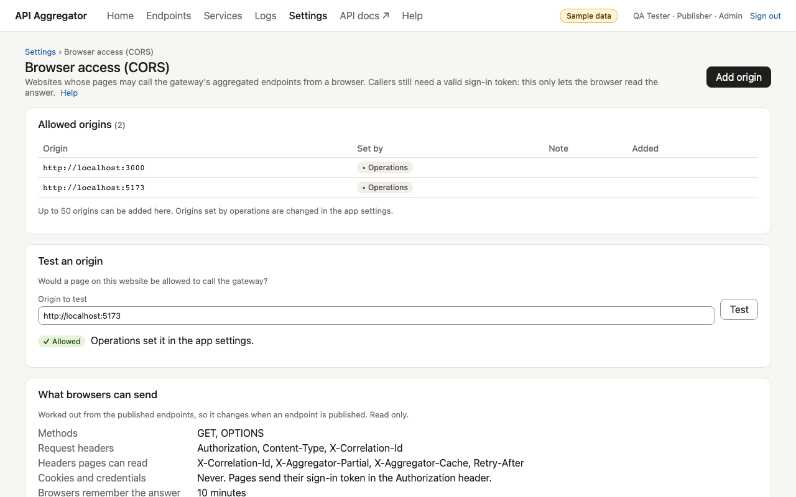

# For app developers

**For:** developers of the web and mobile apps that call the gateway.

The gateway gives your app **one call per screen** instead of several. Each aggregated endpoint is under
`/bff/…` (a *backend for frontend*), returns JSON, and has a typed description in `/bff/openapi.json`.
Your app never talks to the backend services or holds their credentials.

Examples use the local stack from [Getting started](getting-started.md): the gateway at
`http://localhost:5200`, with test tokens from `/dev/token`. Every response below is checked against it
by `scripts/check-docs.sh`.

## Calling an endpoint

```http
GET /bff/customer/C-10042/summary HTTP/1.1
Host: localhost:5200
Authorization: Bearer <the user's access token>
X-Correlation-Id: 7d2c1f0e-checkout-screen      (optional)
```

<!-- check: gateway GET /bff/customer/C-10042/summary scope=customer.read -->
```json
{
  "name": "Alex Example",
  "points": 1250,
  "tier": "gold",
  "orderStatus": "open",
  "orderIds": ["O-042-1", "O-042-2", "O-042-3"],
  "offers": ["Offer for family/gold", "Loyalty bonus"]
}
```

Every response, including errors, has:

| Header | Meaning |
|---|---|
| `X-Correlation-Id` | The id of this request in the gateway's logs. Log it, and show it in support screens |
| `Cache-Control: no-store` | Don't cache it. The data may be personal. The gateway does any caching, per user |
| `X-Aggregator-Partial: true` | Only on a partial answer (see [Partial answers](#partial-answers)) |
| `Retry-After` | Only on errors worth retrying: how many seconds to wait |

Only the inputs an endpoint declares are accepted. Anything else in the query or headers is ignored.

## Signing in and scopes

The gateway accepts the **access token** (a JWT) your app already gets from your identity provider for
the gateway's audience. Ask the platform team for the authority and audience
([Operations](operations.md#configuration-reference): `Auth:Authority`, `Auth:Audience`).

Each endpoint can require a **scope**. The OpenAPI document says which: "Requires scope `customer.read`".
In development, get a test token with any scopes:

```bash
curl -s "http://localhost:5200/dev/token?sub=test-user&scope=customer.read%20people.read"
```

Some endpoints pass **your user's token** on to a backend that trusts the same identity provider, so the
answer is about the signed-in user. `my-preferences` does this. The token was made for `dev-user`:

<!-- check: gateway GET /bff/me/preferences scope=profile.read -->
```json
{ "subject": "dev-user", "language": "en-AU", "contactBy": "email" }
```

## Generating a client

`GET /bff/openapi.json` (OpenAPI 3.0) lists every published endpoint with its inputs, response fields and
errors. It changes when an endpoint is published, so regenerate in your build.

| Platform | Tool | Command |
|---|---|---|
| .NET (MAUI, Blazor, ASP.NET) | NSwag | `nswag openapi2csclient /input:http://localhost:5200/bff/openapi.json /namespace:MyApp.Bff /output:BffClient.cs` |
| .NET | Kiota | `kiota generate -l CSharp -d http://localhost:5200/bff/openapi.json -c BffClient -n MyApp.Bff -o ./Bff` |
| TypeScript | openapi-typescript | `npx openapi-typescript http://localhost:5200/bff/openapi.json -o src/bff.d.ts` |

Fields the gateway can't type for certain are "any value" in the document. It never guesses.

## Errors

Every error is **problem details** (`application/problem+json`) with a stable `code` your app can switch
on, a `correlationId`, and usually `retryable`. Codes are never renamed; new ones may be added, so treat
an unknown code like `server_error`.

```json
{
  "type": "urn:api-aggregator:error:<code>",
  "title": "A sentence you can log",
  "status": 502,
  "code": "<code>",
  "detail": "Which step failed (optional)",
  "correlationId": "…",
  "retryable": false,
  "errors": [ { "step": "…", "name": "…", "service": "…", "code": "…", "status": 404, "message": "…", "retryable": false } ]
}
```

Show your own friendly text, not `title` or `message`: those are for logs and support.

Act on `code` (and `status`), never on `step` or `name`. Those say which part of the endpoint failed, for
logs and support. They can change when someone renames a step in the admin app, so an app that checks
`step == "loyalty"` would break without warning.

### Error codes

| HTTP | `code` | What happened | Retry? | What the app should do |
|---|---|---|---|---|
| 400 | `invalid_input` | A value was missing or wrong. `errors[].message` says which | No | Fix the request. If the user typed it, show the field as invalid |
| 401 | `unauthenticated` | No token, or it's expired or invalid | After signing in | Refresh the token, or send the user to sign in |
| 403 | `insufficient_scope` | The token lacks the endpoint's scope (`requiredScope`) | No | Don't show the feature; ask for the scope to be granted |
| 404 | `not_found` | No endpoint at this address (also after an endpoint is deleted) | No | A bug or an old app version: report it |
| 429 | `rate_limited` | Too many requests from this user (600 a minute by default) | Yes, after `Retry-After` | Back off and try again |
| 500 | `internal_error` | A gateway bug | Once, maybe | "Something went wrong." Report with the correlation id |
| 502 | `auth_failed` | The gateway couldn't sign in to a service | No | "Not available right now." The platform team must fix it |
| 502 | `unauthorized`, `forbidden` | A service refused the gateway's credentials | No | Same as above |
| 502 | `not_found` | A **record** doesn't exist in a service (`errors[].status` 404) | No | Show "not found" for that record |
| 502 | `bad_request` | A service refused the request (another 4xx) | No | Usually an endpoint set-up problem: report it |
| 502 | `rate_limited` | A service said "too many requests" | Yes | Try again after `Retry-After` |
| 502 | `server_error` | A service failed (5xx) | Yes | Try again later; "temporarily unavailable" |
| 502 | `unreachable` | A service couldn't be reached | Yes | Same as above |
| 504 | `timeout` | A service, or the whole endpoint, took too long | Yes | Try again later |
| 502 | `invalid_response` | A service sent something that isn't JSON, or too much | No | Report it |
| 502 | `missing_value` | A value needed for a call was missing, such as an id missing from an earlier answer | No | Usually data-specific: report it with the record |
| 502 | `combine_failed` | Lists from several services couldn't be merged (for example too many records) | No | Report it |

A `not_found` with status **404** means the *address* is wrong. With status **502** it means a *record*
is missing. Check `status`, or `errors[].status`.

Real examples (`correlationId` differs on every call):

<!-- check: gateway GET /bff/customer/C-10042/loyalty token=none expect=401 -->
```json
{
  "type": "urn:api-aggregator:error:unauthenticated",
  "title": "Sign in to use this endpoint.",
  "status": 401,
  "code": "unauthenticated",
  "correlationId": "b9712d22c5cd43ac9b3aacda72e9240c"
}
```

<!-- check: gateway GET /bff/customer/C-10042/loyalty scope=profile.read expect=403 -->
```json
{
  "type": "urn:api-aggregator:error:insufficient_scope",
  "title": "Your sign-in doesn't have permission to use this endpoint.",
  "status": 403,
  "code": "insufficient_scope",
  "correlationId": "d94a05dce5bc4061b70cbde492f4eed5",
  "requiredScope": "customer.read"
}
```

<!-- check: gateway GET /bff/customer/C-10042/nothing expect=404 -->
```json
{
  "type": "urn:api-aggregator:error:not_found",
  "title": "There's no aggregated endpoint at this address.",
  "status": 404,
  "code": "not_found",
  "correlationId": "9324085941534858ae76a4595d7f2d0f"
}
```

<!-- check: gateway GET /bff/customer/10042/loyalty expect=400 -->
```json
{
  "type": "urn:api-aggregator:error:invalid_input",
  "title": "Some inputs are missing or invalid.",
  "status": 400,
  "code": "invalid_input",
  "correlationId": "d45e669267114d5588ef675d3d3fa8c0",
  "errors": [ { "code": "invalid_input", "message": "'id' is not in the expected format." } ]
}
```

<!-- check: gateway GET /bff/customer/C-99999/overview expect=502 -->
```json
{
  "type": "urn:api-aggregator:error:not_found",
  "title": "A required service call failed.",
  "status": 502,
  "code": "not_found",
  "detail": "Get customer: Service A (customers) answered 404.",
  "correlationId": "7c19d1a675a141cca47fa2b6048ed058",
  "retryable": false,
  "errors": [
    {
      "step": "a",
      "name": "Get customer",
      "service": "service-a",
      "code": "not_found",
      "status": 404,
      "message": "Service A (customers) answered 404.",
      "retryable": false
    }
  ]
}
```

A sign-in failure has the title "The gateway couldn't authenticate with a required service." and code
`auth_failed` ([example](adding-services.md#the-callers-own-token-service-j-preferences)). The other codes
have the same shape. The full contract is [ADR 0009](../adr/0009-error-contract-and-logging.md).

### Partial answers

Some steps are optional. When one fails, you still get **200**, with `X-Aggregator-Partial: true` and an
`_errors` list of the same entries as above. The fields that came from that step are `null` (or an empty
list). Customer `C-30003` has no loyalty membership:

<!-- check: gateway GET /bff/customer/C-30003/summary -->
```json
{
  "name": "Jo Trial",
  "points": null,
  "tier": null,
  "orderStatus": "open",
  "orderIds": ["O-003-1", "O-003-2", "O-003-3"],
  "offers": [],
  "_errors": [
    {
      "step": "loyalty",
      "name": "Get loyalty (customer id in the path)",
      "service": "service-i-loyalty",
      "code": "not_found",
      "status": 404,
      "message": "Service I (loyalty) answered 404.",
      "retryable": false
    }
  ]
}
```

Show the screen without that part. Don't treat `null` as zero: "no loyalty points shown" isn't "0 points".

## The correlation id

- Send `X-Correlation-Id` with a value of your own (letters, digits, `-` and `_`, up to 64 characters) to
  tie the gateway's logs to your own. Otherwise the gateway makes one. Either way it comes back in the
  header and in every error body.
- Log it with every failed call. Put it in your app's support or "report a problem" screen.
- Support pastes it into **Logs** in the admin UI to see every step of that request
  ([Troubleshooting](troubleshooting.md#find-one-request)).

<!-- check: gateway GET /bff/customer/C-10042/nothing header:X-Correlation-Id=checkout-7d2c1f0e expect=404 -->
```json
{
  "type": "urn:api-aggregator:error:not_found",
  "title": "There's no aggregated endpoint at this address.",
  "status": 404,
  "code": "not_found",
  "correlationId": "checkout-7d2c1f0e"
}
```

## Calling from a browser

A web page on another website (another *origin*, such as `https://portal.example.com`) can call the gateway
only if that origin is on the gateway's **browser access** list. Otherwise the browser makes the call but
won't let your page read the answer, and the console says *blocked by CORS policy*. Apps on phones and
servers aren't affected.

- **Ask for your origin to be added.** Someone with the admin role adds it in the admin app
  (**Settings → Browser access (CORS)**), or operations add it to the gateway's settings. An origin is the
  scheme, host and port only: `https://portal.example.com`, no path and no slash at the end. In development,
  `http://localhost:3000` and `http://localhost:5173` are already allowed.
- **Send your token in `Authorization`.** Cookies and credentials are never accepted cross-origin, so don't
  set `credentials: "include"`.
- **CORS isn't a permission.** It only lets the browser show you the answer. Every call still needs a valid
  token with the endpoint's scope.

Before the real call, the browser asks the gateway what it may send (a *preflight*). The answer lists the
allowed origin, methods and headers. Headers come from what the published endpoints accept, so an endpoint
with a `header.X-Tenant` input adds `X-Tenant`:

<!-- check: gateway OPTIONS /bff/customer/C-10042/summary token=none header:Origin=http://localhost:5173 header:Access-Control-Request-Method=GET header:Access-Control-Request-Headers=authorization,x-correlation-id expect=204 cors-headers -->
```text
Access-Control-Allow-Headers: Authorization,Content-Type,X-Correlation-Id
Access-Control-Allow-Methods: GET,OPTIONS
Access-Control-Allow-Origin: http://localhost:5173
Access-Control-Max-Age: 600
Vary: Origin
```

The real answer then says which headers your page may read: `X-Correlation-Id`, `X-Aggregator-Partial`,
`X-Aggregator-Cache` and `Retry-After`. Error answers carry the same headers, so your page can read the error
body and its `correlationId`:

<!-- check: gateway GET /bff/customer/C-10042/summary header:Origin=http://localhost:5173 cors-headers -->
```text
Access-Control-Allow-Origin: http://localhost:5173
Access-Control-Expose-Headers: X-Correlation-Id,X-Aggregator-Partial,X-Aggregator-Cache,Retry-After
Vary: Origin
```

A page on an origin that isn't on the list gets no `Access-Control-Allow-Origin`, and the gateway logs the
origin (never the path) so support can see it on the **Logs** page.

```ts
// On https://portal.example.com, signed in with your identity provider (accessToken from its SDK).
const response = await fetch("https://bff.example/bff/customer/C-10042/summary", {
  headers: { Authorization: `Bearer ${accessToken}`, "X-Correlation-Id": crypto.randomUUID() },
  // No credentials: "include". The token is the credential.
});
const correlationId = response.headers.get("X-Correlation-Id"); // readable: the gateway exposes it
if (!response.ok) {
  const problem = await response.json(); // readable too: errors carry the CORS headers
  console.warn(`Gateway said ${problem.code}. Reference: ${problem.correlationId ?? correlationId}`);
} else {
  const summary = await response.json();
  if (response.headers.get("X-Aggregator-Partial") === "true") { /* some parts are null; see _errors */ }
}
```

If the console still says *blocked by CORS policy*: check that the origin on the list matches the page's
address exactly (`https` vs `http`, `www.`, the port), and use **Test an origin** on the Browser access page.



## C# (.NET MAUI, or any HttpClient)

```csharp
using System.Net.Http.Headers;
using System.Net.Http.Json;
using System.Text.Json.Serialization;

public sealed record CustomerSummary(string Name, int? Points, string? Tier, string OrderStatus,
    List<string> OrderIds, List<string> Offers,
    [property: JsonPropertyName("_errors")] List<BffError>? Errors);

public sealed record BffError(string Code, string? Message, bool? Retryable);

public sealed record BffProblem(string Code, string Title, int Status, string? CorrelationId, bool? Retryable,
    List<BffError>? Errors);

public sealed class BffException(BffProblem problem, TimeSpan? retryAfter) : Exception(problem.Title)
{
    public BffProblem Problem { get; } = problem;
    public TimeSpan? RetryAfter { get; } = retryAfter;
    public bool CanRetry => Problem.Retryable == true || Problem.Code == "rate_limited";
}

public sealed class BffClient(HttpClient http, Func<Task<string>> getAccessToken)
{
    public async Task<CustomerSummary> GetCustomerSummaryAsync(string customerId, CancellationToken ct = default)
    {
        using var request = new HttpRequestMessage(HttpMethod.Get, $"bff/customer/{Uri.EscapeDataString(customerId)}/summary");
        request.Headers.Authorization = new AuthenticationHeaderValue("Bearer", await getAccessToken());
        request.Headers.Add("X-Correlation-Id", Guid.NewGuid().ToString("n"));

        using var response = await http.SendAsync(request, ct);
        if (response.IsSuccessStatusCode)
            return (await response.Content.ReadFromJsonAsync<CustomerSummary>(cancellationToken: ct))!;

        // Every error is problem details with a stable code.
        var problem = await response.Content.ReadFromJsonAsync<BffProblem>(cancellationToken: ct)
            ?? new BffProblem("server_error", "No error body", (int)response.StatusCode, null, true, null);
        throw new BffException(problem, response.Headers.RetryAfter?.Delta);
    }
}

// Set up once (MauiProgram.cs):  builder.Services.AddHttpClient<BffClient>(c => c.BaseAddress = new Uri("https://bff.example/"));
// Using it on a page:
try
{
    var summary = await bff.GetCustomerSummaryAsync("C-10042");
    if (summary.Errors is { Count: > 0 }) { /* hide the parts that are null; the rest is fine */ }
}
catch (BffException ex) when (ex.Problem.Code == "unauthenticated") { await SignInAgainAsync(); }
catch (BffException ex) when (ex.CanRetry) { ShowMessage("Temporarily unavailable. Try again in a moment."); }
catch (BffException ex)
{
    logger.LogWarning("BFF call failed: {Code} {CorrelationId}", ex.Problem.Code, ex.Problem.CorrelationId);
    ShowMessage($"Something went wrong. Reference: {ex.Problem.CorrelationId}");
}
```

For automatic retries, add `Microsoft.Extensions.Http.Resilience` and retry only when `CanRetry` is true,
honouring `RetryAfter`. Never retry a 4xx error.

## TypeScript (fetch)

```ts
export interface BffError { code: string; message?: string; retryable?: boolean }
export interface BffProblem { code: string; title: string; status: number; correlationId?: string; retryable?: boolean; errors?: BffError[] }
export interface CustomerSummary {
  name: string; points: number | null; tier: string | null; orderStatus: string;
  orderIds: string[]; offers: string[]; _errors?: BffError[];
}

export class BffCallError extends Error {
  constructor(public problem: BffProblem, public retryAfterSeconds?: number) { super(problem.title); }
  get canRetry() { return this.problem.retryable === true || this.problem.code === "rate_limited"; }
}

export async function bff<T>(path: string, accessToken: string): Promise<T> {
  const response = await fetch(`https://bff.example${path}`, {
    headers: { Authorization: `Bearer ${accessToken}`, "X-Correlation-Id": crypto.randomUUID() },
  });
  if (response.ok) return (await response.json()) as T;

  const problem: BffProblem = await response.json().catch(() => ({ code: "server_error", title: "No error body", status: response.status, retryable: true }));
  const retryAfter = Number(response.headers.get("Retry-After")) || undefined;
  throw new BffCallError(problem, retryAfter);
}

// Using it:
try {
  const summary = await bff<CustomerSummary>(`/bff/customer/${encodeURIComponent(id)}/summary`, token);
  if (summary._errors?.length) { /* hide the parts that are null */ }
} catch (e) {
  if (e instanceof BffCallError && e.problem.code === "unauthenticated") await signInAgain();
  else if (e instanceof BffCallError && e.canRetry) showMessage("Temporarily unavailable. Try again in a moment.");
  else if (e instanceof BffCallError) showMessage(`Something went wrong. Reference: ${e.problem.correlationId}`);
  else throw e;
}
```

With openapi-typescript, replace the hand-written interfaces with the generated types.

## Good to know

- **Personal data.** Responses may hold personal or health information. Don't log response bodies, don't
  cache them on the device longer than the screen needs, and respect `no-store`.
- **Ids in the address.** Values in the path and query can end up in proxy and browser logs outside the
  gateway. For endpoints you design with the platform team, prefer ids that aren't sensitive.
- **Timeouts.** Each endpoint has a time limit, 5 to 8 seconds in the samples. Set your client timeout a
  little higher, so you get the gateway's `timeout` error rather than your own.
- **Rate limit.** 600 requests a minute per user by default. A 429 means back off.
- **Versions.** Publishing a new version changes the answer in place, at the same address. Ask the
  endpoint's owners to add fields rather than rename them, and to tell you before removing any.
