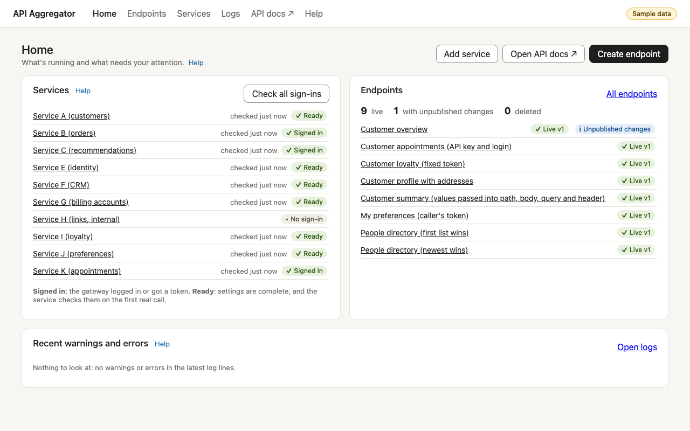
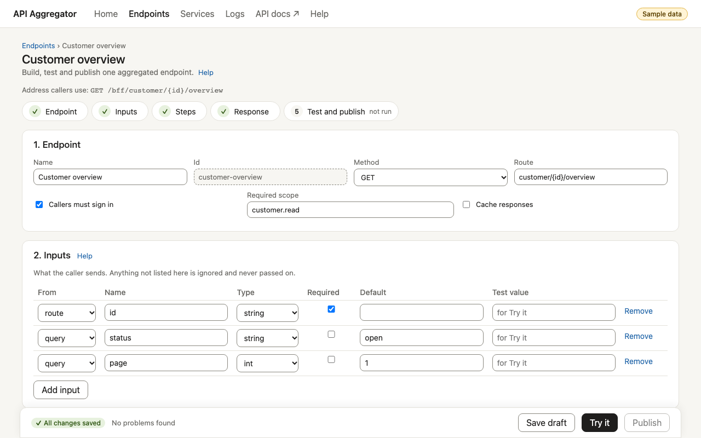

# Getting started

**For:** anyone new to the API Aggregator. **Time:** about 10 minutes.

By the end you'll have the whole product running on your computer and will have called a published
aggregated endpoint, first with the sample data and then with your own configuration.

## What you need

- macOS or Linux (on Windows, use WSL or Docker)
- The [.NET 10 SDK](https://dotnet.microsoft.com/download). Check with `dotnet --version` (it should start with `10.`)
- `curl`, and a browser

## 1. Get the code and build it (2 minutes)

```bash
git clone <this repository> api-aggregator
cd api-aggregator
dotnet build
dotnet test        # optional: everything should pass
```

## 2. Start everything with the sample data (1 minute)

```bash
./scripts/dev-run.sh
```

This starts four programs. Leave the terminal open, because **Ctrl+C** stops them all.

| Program | Address | What it is |
|---|---|---|
| Mock services | http://localhost:5100 | Pretend backend APIs (customers, orders, billing...) with invented data |
| Gateway | http://localhost:5200 | What apps call: `/bff/...` |
| Admin API | http://localhost:5210 | What the admin UI talks to |
| Admin UI | http://localhost:5300 | Where you build and publish endpoints |

The sample data lives in [`samples/config/`](../../samples/config/). The admin UI shows a
**Sample data** badge while it uses it. Nothing you do there touches real systems.

## 3. Look around the admin UI (3 minutes)

Open http://localhost:5300.



- **Home** shows each service with its last sign-in check, the published endpoints and drafts, and recent warnings.
- **Endpoints** lists every aggregated endpoint. Open **Customer overview** to see how it's built.
- **Services** lists the backend APIs and how the gateway signs in to each.
- **Logs** shows what the gateway is doing right now.
- **API docs** opens a page where you can call any published endpoint.



## 4. Call a published endpoint (2 minutes)

Apps call the gateway with a token. In development the gateway hands out test tokens at `/dev/token`:

```bash
TOKEN=$(curl -s "http://localhost:5200/dev/token?scope=customer.read" | sed -E 's/.*"access_token":"([^"]+)".*/\1/')
curl -s -H "Authorization: Bearer $TOKEN" http://localhost:5200/bff/customer/C-10042/loyalty
```

You get one customer's loyalty points:

<!-- check: gateway GET /bff/customer/C-10042/loyalty scope=customer.read -->
```json
{ "customerId": "C-10042", "points": 1250, "tier": "gold" }
```

Now try one that calls **four** services and passes values between them:

```bash
curl -s -H "Authorization: Bearer $TOKEN" http://localhost:5200/bff/customer/C-10042/summary
```

<!-- check: gateway GET /bff/customer/C-10042/summary scope=customer.read -->
```json
{
  "name": "Alex Example",
  "points": 1250,
  "tier": "gold",
  "orderStatus": "open",
  "orderIds": ["O-042-1", "O-042-2", "O-042-3"],
  "offers": ["Offer for family/gold", "Loyalty bonus"]
}
```

Behind that one call, the gateway got the customer from Service A, then called Services I, B and C with
values from A's answer. [Building endpoints](building-endpoints.md) explains how.

**Without curl:** choose **API docs** in the admin UI, pick an endpoint, then **Try it out** and
**Execute**. In development you're already signed in.

`./scripts/try-gateway.sh` calls all the sample endpoints in one go.

## 5. The same thing from the command line (1 minute)

QA and CI can run endpoints without the gateway, using the `aggregator` command-line tool. It reads the
same files. The mock services must be running (step 2), and the tool reads secrets from environment
variables:

```bash
env "Secrets__service-a-password=pass-a" "Secrets__service-i-token=token-i" \
    "Secrets__service-b-password=pass-b" "Secrets__service-c-client-secret=secret-c" \
  dotnet run --project tools/ApiAggregator.Cli -- run customer-summary --route id=C-10042 --config samples/config
```

It shows each call the gateway made, then the answer:

<!-- check: run customer-summary --route id=C-10042 -->
```text
--- run 1: HTTP 200 in 52 ms
    Succeeded customer   200     31 ms  calls=1  GET http://localhost:5100/a/customers/C-10042
    Succeeded loyalty    200      2 ms  calls=1  GET http://localhost:5100/i/loyalty/C-10042
    Succeeded orders     200      8 ms  calls=1  POST http://localhost:5100/b/orders/search
    Succeeded offers     200      2 ms  calls=1  GET http://localhost:5100/c/recommendations?segment=…
```

Query values show as `…`, so customer data never ends up in terminal logs. To check that every endpoint
and sign-in is set up correctly:

```bash
dotnet run --project tools/ApiAggregator.Cli -- validate --config samples/config
```

<!-- check: validate -->
```text
OK   customer-overview v1 (GET /bff/customer/{id}/overview)
OK   customer-summary v1 (GET /bff/customer/{id}/summary)
OK   people-directory v1 (GET /bff/people/directory)
All good.
```

(In bash you can `export` the secrets once instead. zsh's `export` refuses names with dashes, so use `env` as above.)

## 6. Switch to your own configuration (1 minute)

Stop `dev-run.sh` with **Ctrl+C**, then:

```bash
./scripts/dev-run.sh --real
```

Now everything reads and writes [`config/`](../../config/), which starts empty: no services, no
endpoints, and no **Sample data** badge. The mock services still run, so you can practise there before
you connect real ones (Service D at `http://localhost:5100/d/openapi.json` isn't in any config yet).

| | Sample mode | Real mode |
|---|---|---|
| Start with | `./scripts/dev-run.sh` | `./scripts/dev-run.sh --real` |
| Folder | `samples/config/` | `config/` |
| Badge in the UI | **Sample data** | none |
| Use it for | Learning, demos, the guides' examples, tests | Your real services and endpoints |
| Secrets typed in the UI go to | `samples/config/secrets.local.json` | `config/secrets.local.json` |

Both `secrets.local.json` files are ignored by git and used only in development. See
[Adding services](adding-services.md#secrets).

## Next

- Technicians and QA: [Adding services](adding-services.md), then [Building endpoints](building-endpoints.md).
- App developers: [For app developers](for-app-developers.md).
- Running it for real: [Operations](operations.md).
- Something not working? [Troubleshooting](troubleshooting.md).

Running with Docker instead: `docker compose up --build` starts the same four programs on the same ports.
