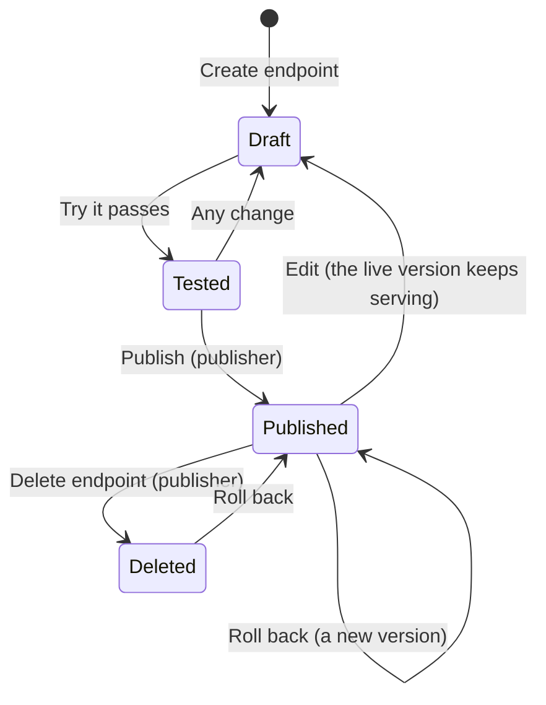
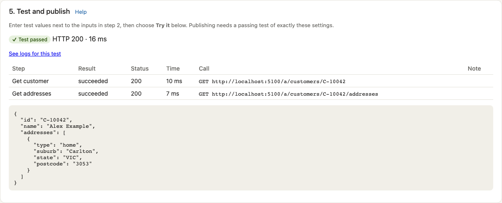
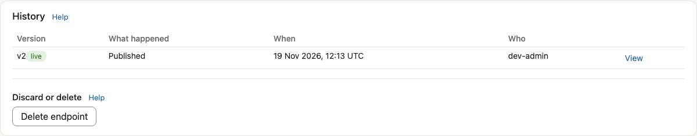
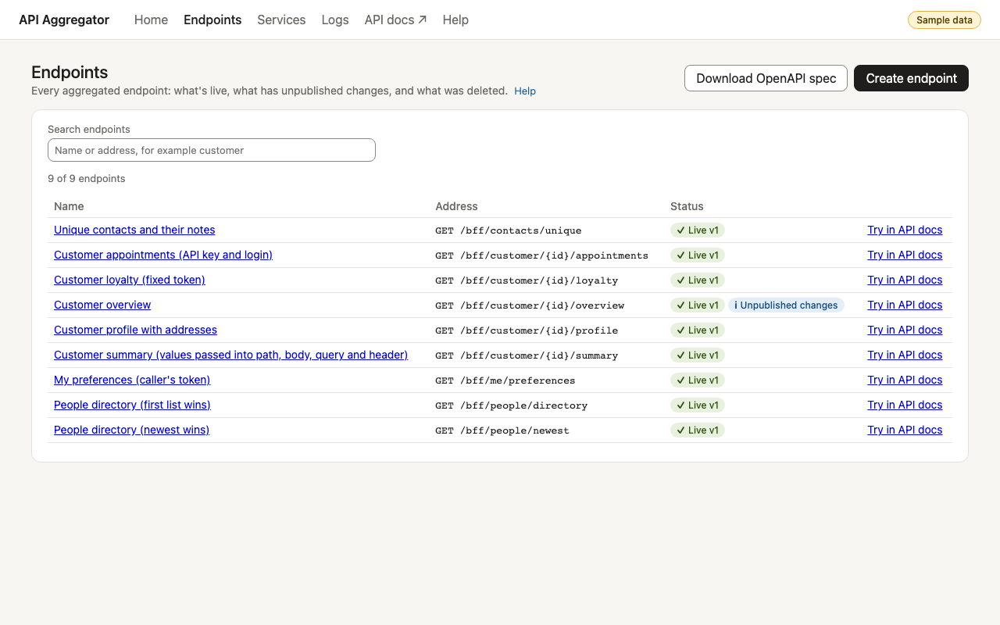

# Testing and publishing

**For:** technicians, QA and approvers.

An endpoint you're building is a **draft**. Drafts are never served to apps. You test the draft with
**Try it**, a **publisher** publishes it, and from then on apps can call it. Every published version is
kept, so you can always see what changed and roll back.



## Try it

In step 5 of the wizard, check the test values next to each input (step 2), then choose **Try it**. The
draft runs against the services for real, with no cache, and you see:

- every call: its status, how long it took, and its address (query values are shown as `…`);
- the combined answer, exactly as an app would get it;
- for a combined list, the counts line (see [Combine lists](combine-lists.md#what-try-it-shows));
- **See logs for this test**, which opens **Logs** filtered to this run's correlation id.



Test more than the happy path:

| Try | With the samples | Expect |
|---|---|---|
| A normal record | `customer-summary`, id `C-10042` | 200, every step succeeded |
| A record with gaps | `customer-summary`, id `C-30003` (no loyalty) | 200 with `_errors` ([see it](building-endpoints.md#optional-steps-nice-to-have-data)) |
| A record that doesn't exist | `customer-overview`, id `C-99999` | 502 `not_found` |
| A wrong value | `customer-summary`, id `10042` | 400 `invalid_input`, before any service is called |
| A record where a condition is false | `customer-overview`, id `C-20001` | `lines` is skipped |

The command line runs the same thing, useful for QA scripts and CI:

```bash
dotnet run --project tools/ApiAggregator.Cli -- run customer-summary --route id=C-30003 --config samples/config
dotnet run --project tools/ApiAggregator.Cli -- validate --config samples/config   # exit code 1 on any problem
```

## Publish

1. Fix everything under **Things to fix**. Look at **Check before publishing** too: those don't block
   publishing, but deserve a second look.
2. **Try it** until it passes (HTTP 200 and not partial).
3. Choose **Publish**.

Publishing needs:

- the **publisher** role (`aggregator.publisher`). Authors can build and test, but not publish;
- a passing **Try it** of **exactly** this draft. Change anything after testing, and you test again.
  Point at the disabled button to see why. Without the publisher role you see "You're signed in as an author: you can save and try it. A publisher
  makes it live." instead. On a developer machine, sign out and sign in again with **Role: Publisher**.

Apps can call the new version within about 2 seconds. Nothing is restarted or redeployed. Editing a
published endpoint creates a new draft, and the live version keeps serving until you publish again.

## Test through the API docs (Swagger)

Every **published** endpoint is listed on the **API docs** page (`/bff/docs`), where anyone can read how it
works and call it.

1. Choose **API docs** in the top bar (or **Try in API docs** next to an endpoint).
2. Pick the endpoint, then **Try it out**, fill in the values and choose **Execute**.
3. In development you're already signed in: the page says so at the top. Anywhere else choose **Authorize** and
   paste a token from your identity provider (ask your identity admin how testers get one).

If the page says nothing about being signed in on a developer machine, sign in by hand: open
`http://localhost:5200/dev/token?sub=qa-user&scope=customer.read%20people.read%20profile.read`, copy the
`access_token` value, choose **Authorize**, paste it on its own (without `Bearer `), then **Authorize** and
**Close**. Those three scopes cover every sample endpoint. A 401 from the gateway means the token is missing
or expired; a 403 `insufficient_scope` means it lacks the endpoint's scope. A 502 naming a service is the
gateway's own sign-in to that service, not your token.

Drafts aren't listed; test them with **Try it** in the wizard. A new endpoint appears within a couple of
seconds. Refresh if you don't see it. The page is on in development and off elsewhere unless an admin
turns it on (`Gateway:ApiDocs:Enabled`).

The page reads the gateway's OpenAPI document, `/bff/openapi.json`:

<!-- check: gateway GET /bff/openapi.json token=none partial -->
```json
{ "openapi": "3.0.3", "info": { "title": "Aggregated endpoints" } }
```

## Test with Postman (or Insomnia, Bruno)

1. In Postman choose **Import**, then **Link**, and paste `http://localhost:5200/bff/openapi.json`. Postman
   creates one request per published endpoint, with its inputs.
2. Get a development token:
   `curl -s "http://localhost:5200/dev/token?scope=customer.read%20people.read"`.
3. On the collection, set **Authorization** to **Bearer Token** and paste the `access_token`.
4. Send `GET /bff/customer/C-10042/loyalty`:

<!-- check: gateway GET /bff/customer/C-10042/loyalty scope=customer.read -->
```json
{ "customerId": "C-10042", "points": 1250, "tier": "gold" }
```

Re-import after publishing to pick up new endpoints. Outside development, ask your identity admin how
testers get a token: `/dev/token` exists only in development.

## History and rolling back

At the bottom of each endpoint, **History** lists every published version, newest first: the number, what
happened (published, rolled back from vN, deleted), when (UTC) and who. The version apps get now is
marked **live**.



- **View** shows a version's address, sign-in, steps and full settings. It changes nothing.
- **Roll back to this** (publishers) makes that version live again **as a new version number**. History
  only grows; nothing in it is changed or removed, and version numbers are never reused. Apps get it
  within seconds. Your unpublished changes are kept.
- A roll back is refused, with the problems listed, if the old version no longer fits today's services
  (for example an endpoint it used was removed). Fix it in the editor, test and publish as usual.

The files: `history/<id>.v<n>.json`, written once each ([ADR 0012](../adr/0012-history-entries-who-when-and-unpublish.md)).

## Discard and delete

- **Discard unpublished changes** removes your draft. The live version keeps serving and opens in the editor.
- **Delete endpoint** (publishers) stops serving it within seconds. Apps that still call it get
  **404 `not_found`**, so check with the app teams first. History is kept, deleted endpoints are listed on
  the **Endpoints** page, and **Roll back to this** on any version brings it back.



## Checklist before publishing

- [ ] Every *suggested* value checked
- [ ] Required scope set (ask your admin which one)
- [ ] Tried a normal record, a record that doesn't exist and a wrong value
- [ ] Optional steps decided (what the app gets when they fail)
- [ ] Caching off, or on with each user getting their own copy
- [ ] No real customer or patient data in test values or sample responses
- [ ] The app team knows the address and has looked at [For app developers](for-app-developers.md)

The lifecycle and the publish gate are explained in
[architecture 04](../architecture/04-admin-and-openapi.md#lifecycle-of-an-aggregated-endpoint).
