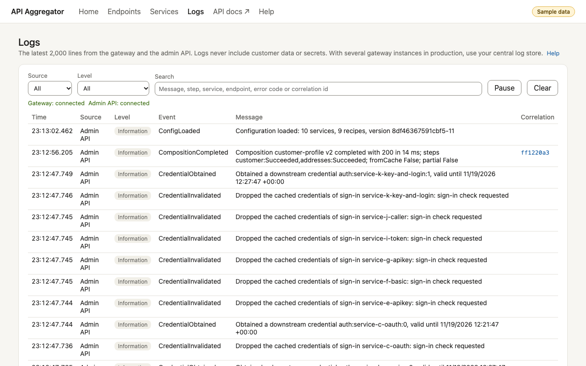

# Troubleshooting

**For:** technicians, QA and support. App developers: start with [the error codes](for-app-developers.md#error-codes).

Find what you see in the left column. Messages are quoted as they appear, and `…` stands for the
name or value they mention.

## Find one request

Every response from the gateway carries a **correlation id**: in the `X-Correlation-Id` header and in
every error body. When an app reports a problem, ask for it.

1. Open **Logs** in the admin UI.
2. Paste the id into the search box, or click the short id on any row. Only that request's lines remain:
   the call, each step that failed, and why.
3. Click a line to see its details: the step, the service, the error code and the internal reason. Each
   step's line names the call by its method and path, e.g. `GET /contacts/{contactId}` (the template, never the
   values), its HTTP status and how long it took.

After a **Try it** run, **See logs for this test** does the same for the test, and **Logs for this step** (under a
step's **Request and response**) shows one step's lines. To see the actual values a call sent and what the service
answered, open **Request and response** in Try it: logs never hold them.



Logs never contain customer data, passwords or keys: only ids, codes and timings. To see the actual
values a step sent, use **Try it**, which shows each call's address (query values masked), or the command
line, which also shows the internal reason:

<!-- check: run my-preferences expect=502 -->
```text
Failed    prefs      -        9 ms  calls=0    The gateway couldn't sign in to Service J (preferences). [auth_failed] — This service needs the caller's token, but the request has none.
```

**When the admin app itself fails** (the page stops responding or shows an error bar), its error line says
which page was open, which endpoint was being edited and the code location, for example
`EndpointEditor.BuildRenderTree (EndpointEditor.razor:200)`. Send those to a developer.

The Logs page keeps the most recent 2,000 lines per program, on this machine only. In production use
your central log store, searching for the same `CorrelationId` ([Operations](operations.md#logs-and-alerts)).

## Sign-in problems

Shown next to the service on **Services** and **Home** after **Check sign-in**, in **Try it**, and in the
logs (event 1200 `DownstreamAuthFailed`). Apps get `auth_failed` (502) and never these details.

| You see | Cause | Fix |
|---|---|---|
| The secret '…' has no value. Add it to Key Vault (or Secrets:… in configuration), or type it in the admin UI under Services > Sign-in. | A password, key or client secret was never saved, or isn't in Key Vault | Development: open the service's sign-in, type it again, save. Elsewhere: ask an admin to add that secret **name** to Key Vault |
| Couldn't reach the sign-in address. Check the URL and that the service is running. | The login or token address is wrong, or the service is down | Check the address with the owner; open it in a browser or Postman |
| Login for profile '…' failed with 401 | Wrong username or password | Re-enter them; confirm with the owner |
| Login for profile '…' failed with 400 / 415 | The login expects a form, not JSON, or other field names | Set **Send login as** to `form`, or set the username and password field names |
| Login for profile '…' returned no session cookie or token. | The login worked, but the answer wasn't what was expected | Ask where the token is in the login answer and set **Token in the login response** |
| Login for profile '…' returned no value at '…' | **Token in the login response** points at the wrong place | Look at a real login answer, for example `{ "data": { "accessToken": "…" } }` → `data.accessToken` |
| Token endpoint for profile '…' answered 400 / 401 | Wrong client id, client secret or scope | Re-enter them; ask the owner which scope to use |
| Token endpoint for profile '…' returned no access_token. | The token address isn't an OAuth token endpoint | Ask the owner for the token endpoint (often ends in `/oauth2/token` or `/connect/token`) |
| This service needs the caller's token, but the request has none. | **Use the caller's own token**, called without a user (CLI without `--token`, or an endpoint with **Callers must sign in** unticked) | Call it as a signed-in user. In the CLI, add `--token <a test token>` |
| Settings and secrets are complete. This sign-in type is checked by the service on the first real call. | Not a problem. Basic, API key and fixed token have nothing to log in to | Prove it with **Try it** |
| Passes on the caller's own token. Check it with Try it, signed in as a test user. | Not a problem | As it says |
| Auth profile '…' step … (…) is missing setting '…' | A required field of the sign-in is empty | Fill it in under the service's sign-in |
| Step … (…): '…' must be a secret reference like secret:my-service-password, not the value itself. | A secret was typed into a plain field (files or API only) | Type it in the UI's password box, or use `secret:<name>` in the file |
| Auth profile '…' uses unknown kind '…' / Step …: unknown kind '…' | A typo in `auth-profiles.json` | Use one of Basic, SessionLogin, OAuthClientCredentials, ApiKey, StaticBearer, PassThroughUserToken |
| … uses the sign-in '…', which doesn't exist. Set its sign-in on the Services page. | The service (or one endpoint) names a sign-in that was deleted or mistyped in the files. The gateway refuses to call it without credentials | Open the service on **Services**, choose **Sign-in** and save one; or fix `authProfileId` in `services.json` |
| Service … answered 401 (in Try it), code `unauthorized` | The service refused the credentials even after a fresh sign-in, or the service has **No sign-in** but needs one | Check the service has a sign-in on **Services**, then the credentials; ask the owner whether the account is enabled |
| Service … answered 403, code `forbidden` | The account works but lacks permission | Ask the owner to grant the gateway's account access |

## Problems shown in the wizard

The wizard shows these next to the field at fault, and in a list under **Things to fix**. The command
line (`aggregator validate`) prints the same text. Anything under **Check before publishing** is a
warning and doesn't block publishing.

### Step 1, Endpoint

| You see | Fix |
|---|---|
| Use lowercase letters, digits and dashes only, e.g. customer-overview. | Change the id. It's made from the name, so a name with only symbols needs a manual id |
| Method must be one of GET, POST, PUT, PATCH, DELETE. | Pick from the list |
| Enter a route such as customer/{id}/overview (no '..' or '?'). | Remove `..` and anything after `?`. Query values are inputs, not part of the route |
| Timeout must be between 100 ms and 60 s. | Usually 5000 to 10000 |
| Cache time must be between 1 second and 24 hours. | Change **Keep for (seconds)** |

### Step 2, Inputs

| You see | Fix |
|---|---|
| The route has {…} but no input 'route.…' is declared. | Add that input. Route values are normally added for you |
| Input names must start with route., query. or header. | For example `query.status` |
| Type must be one of string, int, number, bool, date. | Pick from the list |
| The pattern is not a valid regular expression. | Check the brackets. Ask a developer for complex patterns |

### Step 3, Steps

| You see | Fix |
|---|---|
| Add at least one step. | **Add step** |
| Keep it to 25 steps or fewer. Split very large endpoints in two. | Split it |
| Endpoint '…' was not found. Pick one from the service list. | The service endpoint was renamed or removed. Pick it again |
| '…' (path) is required by … but has no value. | Pick something in **Use value from** |
| '…' (query / header) is required by … but has no value. | The same |
| '…' uses request input '…', which isn't declared under Inputs. | Add that input in step 2 |
| *(Check before publishing)* … sends each order's id as contactId. Did you mean each order's contactId? | The step runs once for each item, but the list you picked gives a different field than the value needs. The calls work but usually find nothing | Under **Run this step**, pick the list the message names. If it really is right, publish anyway: it's only a warning |
| '…' isn't a step here. Did you mean '…'? | A Custom expression uses a step's display name, or an old name. The message names the step it most likely means | Use the suggested name, or pick the value again from the list. To rename a step, change its name and choose **Rename everywhere** ([Renaming a step](building-endpoints.md#renaming-a-step)) |
| A step can't use its own result. | Take the value from an earlier step or an input |
| Steps depend on each other in a loop: … | Step A uses B and B uses A. Change one value to come from an earlier step or an input |
| Header '…' can't be set here. Use the service's auth profile instead. | `Authorization`, `Cookie`, `Host` and similar are set by the sign-in |
| '…' is not a valid target. Use path.x, query.x, header.X-Name, cookie.x or body. | Fix where the value goes |
| Binding to '…' needs exactly one source (a value or a template). | A value has both a source and a template, or neither. Choose one |
| 'item' / 'index' can only be used in a step that runs for each item. | Set **Run once for each item in**, or pick another value |
| For-each must be an expression such as {{b.body.items[*].id}}. | Wrap it in `{{ }}` |
| Max concurrency must be between 1 and 32. | Usually 3 or 4 |
| Step names must start with a letter and use letters, digits or underscore. | For example `getOrders` |
| '…' is a reserved name. Pick another step name. | `request`, `item`, `index`, `ctx` and `combine` are taken |
| Two steps have the same name. | Rename one |
| Unknown transform '…'. Allowed: … | Use one from the list, for example `count` or `join(',')` |
| Steps can't use combined lists; they're built after all steps finish. | Use the step's own result instead |

### Step 4, Response and Combine lists

| You see | Fix |
|---|---|
| '…' refers to a combined list that isn't defined. Use combine.<name> with a name from the Combine section. | Check the spelling, or add the combined list |
| Add at least one source, the list of records to combine. | **Add list** |
| Source … needs a 'from' path, such as crm.body.contacts. | Pick the list |
| Source …: write the path without braces, e.g. crm.body.contacts. | Remove `{{ }}` |
| Source …: '…' must start with the name of a step. Combined lists can only use step results. | Pick a step's list |
| Source … needs a key: the field that identifies a record, such as userId. | Set **Match on** |
| Source …: key '…' isn't a valid field. … | Use a field name such as `userId`; separate several with commas |
| Source … (mapping) needs the field that matches. / the field to use. | Complete the link-list settings |
| Source … (mapping): … must have the same number of fields as the key (…). | Match one field to one field, or two to two |
| Two sources are called '…'. Give each source its own name. | Rename one |
| The owner of '…' is '…', which isn't one of the sources (…). | Pick an owner from the listed sources |
| On conflict must be 'priority' or 'newest:<field>', for example newest:updatedAt. | Choose a rule in **Which list wins** |
| Normalize can only be 'trim' or 'lower', not '…'. | Files only: fix the value |
| Nulls must be 'neverOverwrite' or 'overwrite'. / Without a key must be 'keep' or 'drop'. | Files only: fix the value |
| Max records must be between 1 and 50,000. | Change it under **More options** |
| Sort by must be a field name, optionally starting with '-' for descending, e.g. -updatedAt. | Pick a field |
| Two combined lists have the same name. / Combined list names must start with a letter… | Rename it |
| '…' is also the name of a step, so the default answer would mix them up. Rename the combined list. | Rename it |
| **Warning:** Matching on '…' can merge different people's or customers' records. Use an id that both services share, or link them with a mapping step. | Don't match on names, emails, phones or dates of birth. See [Combine lists](combine-lists.md) |
| **Warning:** The combined list '…' isn't used in the response. | **Add to response**, or remove it |

## Try it and publishing

| You see | Cause | Fix |
|---|---|---|
| Run a successful test of this exact draft before publishing. | Something changed after the last passing test, or it didn't pass | **Try it** again, then **Publish** |
| Fix the problems before publishing. | There are items under **Things to fix** | Fix them |
| Publish needs a passing Try it of exactly these settings (when you point at **Publish**) | Not tested since the last change | **Try it** first |
| You're signed in as an author: you can save and try it. A publisher makes it live. (instead of a **Publish** button) | You don't have the publisher role (`aggregator.publisher`). The top bar shows your role | Ask a publisher to publish it. On a developer machine, sign out and sign in again with **Role: Publisher** |
| Someone else published this endpoint at the same moment. Reload the page, check the history, and try again. | Two people published together | Reload and check **History** |
| Version … can't go live as it is, because the services it uses have changed. … | Roll back to a version that uses something since removed | Open it, fix the problems, test and publish |
| Try it is **partial** (200 with `_errors`) | An optional step failed | Fine for apps; publishing still needs a test that isn't partial, so use a record where every step works |
| Service … answered 404 | The test record doesn't exist, or the path is wrong | Try another test value; check the endpoint path |
| Service … answered 400, code `bad_request` | The service didn't like a value, often a missing required one | Compare the call's address in **Try it** with the owner's example request |
| … didn't answer in time., code `timeout` | The service is slow, or the step's timeout is too short | Try again; ask the owner; raise the service's timeout |
| … couldn't be reached., code `unreachable` | Wrong base address, or the service is down or not reachable from the gateway | Check the base address and the network path |
| … returned an invalid response. / The response from … was too large. | The answer isn't JSON, or is over 5 MB | Check the endpoint; ask for paging |
| Not run because '…' failed. [dependency_failed] | An earlier step it needs failed | Fix that step first |
| Condition not met. (skipped) | **Only run when** was false | Not a problem. Check the condition if you expected it to run |
| A value is `null` in the answer | The field doesn't exist in that service's answer (a typo, or the service changed), or its step failed or was skipped | Compare with the step's answer in **Try it** |

## Adding services

| You see | Fix |
|---|---|
| That doesn't look like an OpenAPI or Swagger document. | The address returns something else, often a web page. Ask the owner for the JSON or YAML spec address |
| Importing from '…' isn't allowed. Ask an admin to add it to Admin:OpenApiAllowedHosts. | As it says |
| Give either a spec URL (http/https) or the spec text. | Paste the address, or the spec itself |
| Base URL must be an http or https address. | For example `https://billing-test.internal/api` |
| Give the service a name of up to 100 characters. | Shorten it |
| Published endpoints still use this service: …. Change or delete those endpoints first. | Delete is blocked; change or delete those endpoints first |
| Secrets are managed in Key Vault in this environment. Ask an admin to add it there. | Send the admin the secret's **name** |
| The auth profile has problems. | The details are listed below it; see [Sign-in problems](#sign-in-problems) |

## What apps report

| The app gets | Look at | Usually fixed by |
|---|---|---|
| 401 `unauthenticated` | The app's sign-in, the token's expiry and audience | The app developer |
| 403 `insufficient_scope` | `requiredScope` in the answer, and the token's scopes | The identity admin granting the scope, or the endpoint's scope being changed |
| 404 `not_found` (status 404) | The address. Was the endpoint deleted or renamed? | Publishing it again, or fixing the app |
| 400 `invalid_input` | `errors[].message` | The app developer |
| 502 `auth_failed` | **Services**: the sign-in pill, then **Check sign-in** | Fixing the sign-in or secret ([above](#sign-in-problems)) |
| 502 `not_found`, `bad_request` | The logs for the correlation id: which step and which service | Usually real data. Otherwise the endpoint's set-up |
| 502/504 `server_error`, `unreachable`, `timeout` | The service's own health | The service owner. The app should retry later |
| 502 `unreachable` right away, logs say "The call wasn't made: BrokenCircuitException" | That service failed many calls in a row, so the gateway stopped calling it for a few seconds (its circuit breaker). Other services aren't affected | The service owner. Calls resume by themselves once the service answers again |
| 429 `rate_limited` | Whether one user or app is calling in a loop. Many different callers without a token getting it at once: the gateway sees them all as one address (see [Operations](operations.md#overload-and-broken-services)) | The app developer, or the platform team enabling forwarded headers |
| 503 `overloaded` | The gateway's limit of requests at once (`Gateway:MaxConcurrentRequests`) was reached, usually because a slow service is holding requests | The platform team: scale out, or find the slow service in the logs (`StepFailed`, `timeout`) |
| 500 `internal_error` | The gateway logs for the correlation id | The platform team |
| The browser console says *blocked by CORS policy* (the web app gets no answer at all) | **Settings → Browser access (CORS)**: **Test an origin** with the page's origin. The Logs page shows "Browser origin … is not allowed" | Someone with the admin role adding the origin, written exactly (`https`, `www.`, port). See [Calling from a browser](for-app-developers.md#calling-from-a-browser) |

Still stuck? Collect the correlation id, the endpoint and the time, and ask the platform team. Never send
tokens, passwords or real customer data in the request.
